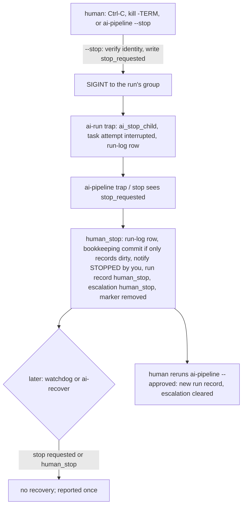

# Plan: Flow batch 11: run controls (RC-01: G1, G2, G3, G4–G7, G9, G11)

## Assessment (verified at 4fea72d, 2026-10-21)
See `.ai/project-spec.md`, "Verified against the code". In short: nothing in the toolkit tells a
human stop from a failure. An interrupt waits for the whole agent session, then lands in `stop()`,
which hands over to auto-recovery; a killed pipeline looks like a crash to the watchdog. The only
record of a run is one manifest per checkout without process or time data, and a stop is
described only in English text. Task edits by humans or apps need a hand commit and have no lock.

The common shape of this batch (AD-4): small host records outside the checkout, one owner per
record, atomic writes, schema-versioned, read by the toolkit and by apps; the checkout's
`.ai/local` stays a convenience copy that is never trusted for authority.

## Design

### Records and paths (all under `<binding dir>` = `<state root>/reviews/<16 hex>/`)
- `runs/<id>.json`, `runs/current` (the id, one line), `runs/.lock` (flock for read-modify-write).
- `escalation.json` (one at a time, beside `run.json`).
- `skips-<16 hex of sha256(branch)>.json` (SKIPPED host record).
- Log of a detached run: `<checkout>/.ai/local/pipeline-<UTC stamp>-<8 hex>.log`.

### Run record, schema 1 (T301 helper, T302 wiring)
```json
{"schema": 1, "id": "20261021T210000Z-12345", "kind": "pipeline", "checkout": "/abs/path",
 "branch": "fix/x", "base": {"ref": "origin/main", "sha": "<40 hex>"}, "argv": ["--approved", "..."],
 "launcher": "terminal", "log": null, "started": "2026-10-21T21:00:00Z",
 "process": {"pid": 12345, "pgid": 12345, "sid": 12000, "start_ticks": 987654},
 "resumes": 0, "stop_requested": null, "ended": null, "outcome": "running", "detail": ""}
```
- `kind`: `pipeline` or `ai-run`. `base` null for `ai-run`. `argv` is the exact argument array
  (`orig_args` with the resolved `--knowledge-dir`, as the manifest).
- `outcome`: `running`, `finished`, `stopped` (stopped for a human), `human_stop`, `paused` (a
  usage-limit relaunch is scheduled), `crashed` (the watchdog found the process gone).
- `stop_requested`: null or `{"at": ISO, "via": "ai-pipeline --stop" or "signal"}`.
- `detail`: at most 200 characters, one line, no `|`.
- `workflow.py run-record` actions: `start KIND BRANCH BASE_REF BASE_SHA -- ARGS…` (new record,
  process identity of the caller's parent shell given by `--pid PID`, prunes to 20, writes
  `current`), `resume --pid PID` (current record: new process, `resumes`+1, outcome `running`),
  `end OUTCOME [DETAIL]`, `request-stop VIA`, `stop-requested` (exit 0/1), `current` (prints the
  path), `show [ID]` (prints the JSON), `alive` (exit 0 when the recorded process exists with the
  same start ticks and is not a zombie). Readers accept unknown extra fields; an unknown
  `schema` is treated as no record.

### G2: interrupts reach the child (T303 sessions, T304 review and gate)
`common.sh`:
```bash
# Run a long child (a timeout-wrapped session or gate) so a trapped INT/TERM can end it at once.
ai_run_child() { "$@" & AI_CHILD_PID=$!; local code=0; wait "$AI_CHILD_PID" || code=$?; AI_CHILD_PID=''; return "$code"; }
# From a trap: TERM the child (timeout forwards it and kills after 10 s), wait for it to end.
ai_stop_child() { … kill -TERM "$AI_CHILD_PID"; wait up to 20 s … }
```
Each call site changes from `timeout …` to `ai_run_child timeout …` (redirections stay on the
call); the traps become `trap 'ai_stop_child; exit 130' INT` / `… 143' TERM`. `ai-check`'s
`| tee` becomes `> >(tee "$log") 2>&1` so `$!` is `timeout`. Exit codes are the child's.

### G1: human stop (T306 trap, T307 recovery and watchdog, T308 `--stop`)

- `ai_human_stop SIGNAL` (common.sh, used by ai-pipeline and ai-recover; idempotent through
  `AI_HUMAN_STOPPED`): `ai_stop_child`; `ai_log "$active" "stopped by the human ($sig)"` (skipped
  while armed); `git commit` of state/run-log/handoff only when nothing else is dirty (subject
  `chore(ai): record stop by the human`, gate re-checked, skipped while armed); `ai_observe stop
  '' 'stopped by the human'`; `ai_notify "⛔ STOPPED by you: $branch during $stage. Partial work is
  kept uncommitted; rerun ai-pipeline --approved … to continue."` (the "Partial work…" clause only
  when the checkout is dirty); `last-error` = `stopped by the human during <stage>`, then
  `last-error.notified`; `run-record end human_stop`; `escalation write human_stop <stage>`;
  `ai_drop_marker`; exit 130 or 143.
- `ai-pipeline` tracks the current stage in a shell variable set by `step` (no new observation).
- `--stop`: bash dispatch at the top of `ai-pipeline` (before option parsing): `cd` into the
  checkout (`git -C CHECKOUT rev-parse --show-toplevel`), then `exec python3 workflow.py run-stop
  [--wait S]`. `run-stop`: read `current`; no record, ended record, or process gone → handle the
  scheduled relaunch case (manifest `limit_relaunch_at` present: write the stop request, `end
  human_stop`, escalation, exit 0 "Cancelled the scheduled usage-limit relaunch") else exit 3; a
  record whose process is gone but outcome `running` (killed) → write the stop request and exit 3
  "no run active (its process is gone; recorded as stopped by you)". Otherwise: `request-stop`,
  re-read identity, `os.killpg(pgid, SIGINT)` when `pgid == pid` else `os.kill(pid, SIGINT)`,
  poll every 0.2 s up to `--wait`; ended → if outcome is not `human_stop` (the trap did not run),
  `end human_stop`, escalation `human_stop`, remove the marker when it holds the recorded pid;
  exit 0. Still alive → exit 4.

### G9: escalation record, schema 1 (T305 helper, T309 wiring)
```json
{"schema": 1, "kind": "task_blocked", "stage": "implementation", "run": "<run id>",
 "branch": "fix/x", "created": "ISO", "tasks": ["T305"],
 "evidence": {"last_error": "redacted excerpt", "review": ".ai/reviews/current.md",
              "findings": ["M1"], "log": "/abs/log or null"},
 "answers": [{"id": "retry_task", "label": "Return T305 to TODO with a note",
              "argv": [".ai/bin/ai-task", "retry", "T305", "--note", "{note}", "--commit"]},
             {"id": "resume", "label": "Start the run again with its approved arguments",
              "argv": [".ai/bin/ai-pipeline", "--approved", "..."]}]}
```
- `workflow.py escalation write KIND STAGE [--task ID]… [--finding ID]… [--review PATH]`,
  `hint KIND [--task ID]… [--finding ID]…` (host-side pending kind, consumed by the next write),
  `show`, `clear`. `write` reads `.ai/local/last-error` through the pinned `.ai/local` (regular
  file, ≤ 64 KB), redacts it (spec B10), takes the run log path from the current run record and
  the recorded arguments from the manifest.
- Answers per kind (always ending with `resume` when a manifest exists): `task_blocked` →
  per task `retry_task`, `skip_task`, `set_model`; `plan_review_limit` → `resume` (a human start
  resets the budget) and `resume_skip_plan_review`; `fix_round_limit` → `resume_more_rounds`
  (recorded args with `--max-fix-rounds` + 1, only when ≤ 5); `needs_human_question` →
  `review_plan` (`.ai/bin/ai-review --plan`, after answering in
  `.ai/reviews/plan-dispositions.md`; G8 is later work) then `resume`; `validation`, `crash`,
  `human_stop`, `usage_limit` (with `not_before` epoch when known), `other` → `resume`.
- Producers (T309): hints right before the stop at `plan_decision_check` (needs_human_question,
  finding ids from the questions), the `revision-reserve` refusals (plan_review_limit), the AI_SUPERVISE=0
  plan review stop (plan_review_limit), `ai-run`'s "none can run" (task_blocked, the BLOCKED ids),
  `ensure_validated` (validation), `ai_limit_pause` beyond the budget (usage_limit), the fix-round
  limit break (fix_round_limit, written at `finish`). Writers: `stop()` non-recovery path,
  `ai_die` inside a pipeline (common.sh, best effort), `ai-recover` `escalate()`, `ai-run`'s
  stand-alone `on_exit`, the watchdog's crash report when it does not recover (kind `crash`, plus
  `run-record end crashed`). Clear: `run-manifest start` (human start) and `ai-recover`'s
  `resume()`.

### G7, G4, G5, G6: task commands (T310 lock and commit, T311 SKIPPED, T312 subcommands)
- `ai-task` mutating forms: `set ID STATUS --commit`, `retry ID --note TEXT [--commit]`, `model ID
  MODEL [--commit]`, `skip ID --reason TEXT [--commit]`. Shared bash function `task_change`: lock
  `.ai/local/workflow.lock` on fd 9 with `flock -n` (held → exit 75), branch check (not detached,
  not protected), with `--commit` a clean checkout first, run the helper, `ai_helper tasks check`
  (failure → restore the saved bytes, exit 1), then with `--commit` `git commit --only -m MSG --
  .ai/tasks.md` and a clean check (failure → "changed but not committed", exit 1, nothing
  reverted). Messages: `chore(ai): set T305 to TODO (ai-task)`, `chore(ai): return T305 to TODO
  (ai-task)`, `chore(ai): note on T305 (ai-task)`, `chore(ai): set T305 model to opus (ai-task)`,
  `chore(ai): skip T305 (ai-task)`.
- Text arguments: one line, 1–500 characters, no control characters, no backticks.
- SKIPPED (T311): `tasks()` accepts it; it satisfies dependencies only with a matching host skip
  record (else `T…: SKIPPED without a host skip record (use ai-task skip)`); `next` skips it;
  `complete` = every task DONE or SKIPPED; `untouched` and `newly-done` unchanged (DONE only);
  `counts`/`progress` count DONE only; `tasks set` refuses SKIPPED; the planning DONE-block guard
  (the "DONE task was changed or removed" check) covers SKIPPED blocks; `pr-body` adds "Skipped
  tasks: T… (reason)". `workflow.py tasks skip ID REASON` (refuses DONE, IN_PROGRESS, SKIPPED and a
  task an unfinished task depends on) writes the status, the `Skipped (DATE, ai-task skip): REASON`
  line under `### Result / notes` and the host record.

### G11: `--detach` (T313)
Bash dispatch at the top of `ai-pipeline`: `--detach` must be first; the rest must contain
`--approved`. Name `pipeline-<stamp>-<hex>.log`. With `systemd-run` executable:
`systemd-run --user --collect --quiet --service-type=exec --unit=ai-pipeline-<base name>-<epoch>
--working-directory=<checkout> --setenv=…(PATH, XDG_CONFIG_HOME, XDG_STATE_HOME, AI_*) --setenv=
AI_LAUNCHER=detach-systemd --setenv=AI_RUN_LOG=<abs log> -- python3 -I <AI_BIN>/lib/workflow.py
exec-logged <name> -- <AI_BIN>/ai-pipeline <args>`; else the `ai-plan` form with `setsid` and
`AI_LAUNCHER=detach-setsid`. Then poll `run-record show` up to `AI_PLAN_ACK_SECONDS` for a record
started after the launch whose `log` is this log; print `Pipeline started: pid N, log PATH`,
`Follow: tail -f PATH`, `Stop: <AI_BIN>/ai-pipeline --stop <checkout>`; not confirmed → exit 1
with the log's last lines, the service left running.

## Task map
| Task | Gap | Model | What |
| --- | --- | --- | --- |
| T301 | G3 | opus | run record helper, schema, host lock, retention |
| T302 | G3 | sonnet | run records written by ai-pipeline, ai-recover and stand-alone ai-run |
| T303 | G2 | opus | `ai_run_child`/`ai_stop_child`; ai-run and ai-recover sessions |
| T304 | G2 | opus | the same for ai-review, ai-check and dependency setup |
| T305 | G9 | opus | escalation record helper, redaction, answers |
| T306 | G1 | opus | ai-pipeline INT/TERM trap and `stop()` honour a stop: human stop |
| T307 | G1 | opus | ai-recover and the watchdog never resume a human stop |
| T308 | G1 | opus | `ai-pipeline --stop [CHECKOUT] [--wait S]` |
| T309 | G9 | opus | escalation hints and writes at every human stop; cleared on resume |
| T310 | G7 | opus | ai-task lock and `--commit` |
| T311 | G6 | opus | SKIPPED status and the host skip record |
| T312 | G4 G5 G6 | sonnet | `ai-task retry`, `model`, `skip` |
| T313 | G11 | sonnet | `ai-pipeline --detach` |
| T314 | docs | haiku | README, docs/workflow.md, flow chart audit, mission-control handoff note |

## Risks
- Trap ordering in bash: a trap runs after the foreground child returns. T303/T304 make every long
  child a background child waited with `wait`, so the trap runs at once; T306 tests the pipeline
  in each long stage it can be in (session, gate, review, sleep).
- Batch 10 conflicts: `scripts/ai-run` gets one-word changes at the session call and the traps,
  plus two run-record calls; `ai-pipeline` gets the dispatch at the top, traps, the run-record and
  escalation calls; nothing near line 478 (plan review entry) changes.
- Lock interplay: `--stop` never takes the checkout lock (the pipeline holds it); `ai-task`'s
  mutating forms never wait for it.
