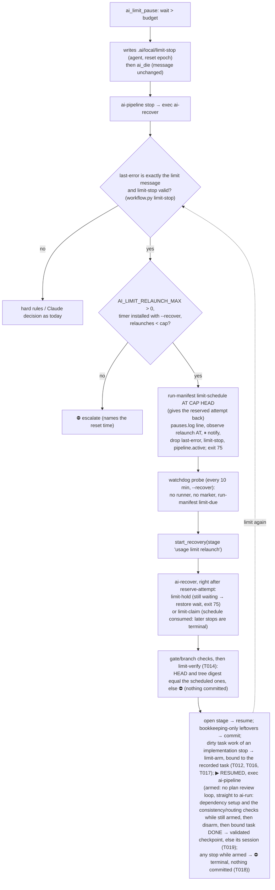

# Plan: Limits and plan stage: MC-01 part 1, DB-04, R15

## Assessment (verified at edc3dc6, 2026-10-17)
See `.ai/project-spec.md` "Verified against the code". In short: limit stops beyond the wait
budget escalate as a hard rule and nothing relaunches them; `ai-run --plan` and the nine-box
dashboard exist, but there is no `ai-plan` command, no read-only reference directories, no
detached start, no outcome/run-log record and a killed planning session looks idle; the PR step
can draft but never un-drafts and does not remember that it drafted.

## Architecture

### MC-01 part 1 — limit-only stop → scheduled relaunch (T001 helpers, T002 watchdog, T003 ai-recover, T004 dashboard)

- **Record (T001).** `ai_limit_pause` writes `.ai/local/limit-stop` (`<Agent> <reset epoch or 0>`,
  via a temp file and `mv`) just before its `ai_die`; the die message stays byte-identical (the
  existing hard-rule pattern and docs keep working). `workflow.py limit-stop` prints
  `<Agent> <relaunch epoch>` and exits 0 only when `.ai/local/last-error` holds exactly one line
  matching `^(Claude|Codex) usage limit: the reset is beyond the \d+s wait budget\. Rerun after
  it resets\.$`, `limit-stop` parses, names the same agent, and is not older than last-error by
  more than 120 s (a stale file from an earlier stop never qualifies). Relaunch epoch:
  `reset + 60` when the reset is in the future, `now + AI_LIMIT_RETRY` (default 1800) when it is
  0, `now` when it has passed. "Only reason" = the whole last-error is the limit message.
- **Schedule (T001).** New run-manifest actions, all atomic on `run.json` (fields
  `limit_relaunches`, `limit_relaunch_at`, `limit_head`, `limit_resume` optional, so existing
  manifests stay valid; a human `start` drops them; `clear-attempts`, called by `finish`, resets
  them): `limit-schedule AT CAP HEAD`, `limit-due [NOW]` and `limit-at` (read only, watchdog),
  `limit-hold [NOW]`, `limit-claim [NOW]`, `limit-verify HEAD` / `limit-arm HEAD` /
  `limit-armed HEAD` / `limit-disarm`, `limit-count`; exact semantics in T001 and "Relaunch
  schedule lifecycle" below (T012 extends the verify/arm family to the tree digest; T016 adds
  the STAGE argument and `limit_stage`, so the arm is granted only for an `implementation`
  stop). New setting
  `AI_LIMIT_RELAUNCH_MAX` (0–9, default 2) in `RUN_SETTINGS`, `ai_config`'s key list and both
  lists in `ai-recover`. `limit-stop` is written by `workflow.py limit-stop-write` through the
  pinned `.ai/local` descriptor and `write_record` (exclusive `O_NOFOLLOW|O_NONBLOCK` temp,
  `os.replace` on the descriptor), never by a shell redirection (P6).
- **Relaunch schedule lifecycle (plan review round 1, P1–P3).** The schedule has three states
  and every `ai-recover` decides on it right after `reserve-attempt` and the settings restore,
  before any escalation can run:
  - *pending* (`AT > now`): `limit-hold` gives the reservation back; ai-recover restores the
    wait (removes last-error, limit-stop, the stale marker; appends the same `pauses.log` line
    the scheduling path writes; `observe relaunch`; ⏸ again) and exits 75. This makes
    scheduling idempotent across a kill between `limit-schedule` and the cleanup: the
    watchdog's crash recovery for the dead marker, or any early recovery, never schedules twice
    (cap unchanged) and never retries before the reset. The watchdog does not depend on that
    restoration: its stall rule reads the pending schedule from the manifest itself (plan
    review round 3, P2; see "Watchdog").
  - *due* (`AT <= now`): `limit-claim` consumes it in the same write that gives the attempt
    back. From here every stop is that relaunch's own terminal ⛔ (or the normal recovery rules
    after the resume); no later probe sees a due schedule, so a branch switch, a changed gate or
    `AI_AUTO_RECOVER=0` produce exactly one ⛔ and no launch loop.
  - *none*: today's behaviour.
  *Preserved task work (T011).* A limit stop inside an implementation session leaves its edits
  (task IN_PROGRESS, source). The claimed relaunch does not commit them and does not escalate:
  when the tree is dirty after recording the bookkeeping leftovers and HEAD still equals
  `limit_head`, it arms the manifest (`limit_resume = HEAD`). The resumed `ai-pipeline` and
  `ai-run` accept exactly that tree through one predicate, `clean_or_armed`, at every
  cleanliness check between the resume and ai-run's first session ("Armed-tree acceptance"
  below, T015: ai-pipeline ~123, both tests of `reconcile_disputes` ~326/~349, ai-run ~148),
  only on a resume, and ai-run consumes the arm immediately before its first act (T019). The normal session reconciles the work ("Reconcile
  interrupted work first"); DONE still needs `ai-check`, the checkpoint guard and
  committed-matches-worktree, as for any task. Chosen over a recovery WIP commit (would commit
  unvalidated content) and over the Claude decision session (the reviewer's and the decision's
  point: a limit is not a human problem). HEAD moved since the stop → ⛔.
- **Preserved-work resume (plan review round 2 redesign, T012 + T011).** Round 1 (P3) and
  round 2 (P3, P9) both found gaps in the preserved-work exception, so the area is specified
  as a whole instead of patched per symptom:
  - *Binding.* The exception admits a TREE, not a commit. `workflow.py worktree-digest`
    (T012) is the existing `tree_snapshot(root)` (workflow.py ~2245: HEAD, the staged diff,
    every non-ignored path outside `.ai/local/` with kind, mode and bytes or link target,
    submodules recursively through their own HEAD, index and working contents, uninitialised
    submodules walked on the filesystem). No second digest implementation (plan review round
    3, P10: a digest that records a gitlink as `dir` misses edits and commits inside a
    submodule, which change neither the parent HEAD nor its index). Tracked bookkeeping
    (`.ai/state.md`, `.ai/run-log.md`, `.ai/handoff.md`, `.ai/reviews/`) is INCLUDED.
    `limit-schedule AT CAP` records `limit_head` and `limit_tree` computed by the helper
    itself; `limit-verify` (no argument) recomputes both and compares them with the recorded
    ones (read only); `limit-arm` (no argument) recomputes both and arms
    (`limit_resume = {head, tree}`) only on an exact match; `limit-armed` (no argument)
    recomputes and compares at every acceptance site. Any difference (a human edit, an added
    file, a staged change, a commit, a submodule change) → ⛔ with `nothing was committed.`,
    the arm is not set and the tree is left as it is.
  - *Verification point (plan review round 3 redesign, T014).* Round 3 (P9, P10) found the
    verification placed after checkout mutations and the digest incomplete, so the relaunch's
    acceptance of the checkout is now ONE contract with one verification site:
    1. `limit-schedule` records HEAD and the tree digest AFTER the stop's bookkeeping was
       written and BEFORE ai-recover's own leftovers commit (T003 schedules before the hard
       rules), so the recorded digest is exactly the checkout the relaunch must find. After
       scheduling, the host writes nothing tracked: ai-recover's cleanup and the watchdog touch
       only `.ai/local/` and host state.
    2. The claimed relaunch verifies first: `relaunch_verify` (one shell function in
       ai-recover, called at exactly one site) runs `run-manifest limit-verify` right after the
       gate and branch checks and BEFORE the plan-revision decision block, the open-stage
       resume, the leftovers commit and anything else that reads the checkout to decide. A
       mismatch escalates with the helper's reason (`the branch moved to another commit while
       the usage-limit relaunch waited; nothing was committed.` for HEAD, `the checkout changed
       while the usage-limit relaunch waited; nothing was committed.` for the tree) and the
       checkout is left exactly as found: no commit, no stash, no checkout, no resume, no
       session. This covers the three cases the round 2 design missed: a human edit confined to
       bookkeeping files (previously committed by the leftovers block, which then resumed a
       clean checkout unverified), a clean checkout whose HEAD moved (previously resumed), and
       an in-scope human edit while a triage or plan-revision stage is open (previously
       resumed and completed by the pipeline).
    3. Only after a passing verification does the relaunch transform the checkout, and only
       in these host-owned transitions of the verified tree: an open stage → `resume` (the
       stage's own leftovers, verified identical); a dirty tree confined to `.ai/state.md`,
       `.ai/run-log.md`, `.ai/handoff.md` → the existing leftovers commit (the stopped run's own
       stop records) → clean → `resume`; a dirty tree with anything else → `limit-arm`
       (recomputes; equal because nothing touched the checkout since the verification, under
       the lock) → `resume`; a clean tree → `resume`. `limit-arm` failing here is an internal
       inconsistency and escalates with the same wording; it is no longer the first check.
    4. `limit-armed` at ai-pipeline's and ai-run's acceptance sites (T011) recomputes against
       `limit_resume` in the same exec chain under the same lock, so a passing arm passes there.
  - *Armed-tree acceptance (plan review round 4 redesign, T015).* Round 4 (P3) found a fourth
    site on the resume path that refuses the armed tree (the final cleanliness check of
    `reconcile_disputes`, ai-pipeline ~349, reached with a settled `verified` re-check); the
    earlier design enumerated sites one by one (ai-pipeline ~123–125, `reconcile_disputes`
    ~326, ai-run ~148–149), which is how each round found one more. The acceptance of the armed
    tree by the resumed run is now ONE contract for the whole path from the resume's
    `exec ai-pipeline` to ai-run's `limit-disarm`:
    1. *One predicate.* `clean_or_armed`: true when `git status --porcelain
       --untracked-files=all` is empty, or when `armed_resume` holds (the process is a resume,
       `run-manifest limit-armed` recomputes HEAD and the tree digest and finds them equal to
       `limit_resume`, and no stage is open). Every check on that path that today requires a
       clean checkout goes through it: ai-pipeline start-from-clean (~123–125), both
       cleanliness tests of `reconcile_disputes` (~326 with status `none`, and the final one at
       ~349 whatever the status), ai-run start-from-clean (~148–149). No other `git status`
       test exists on that path; the ones after ai-run's first session (~507, `publish_ready`,
       `ensure_validated`) are unchanged and never see an armed tree, because ai-run consumed
       the arm and checkpointed or validated before they run.
    2. *No host write while armed.* Between the resume and `limit-disarm` the host makes no
       commit and writes no tracked file while the tree is armed. Where the path could commit
       (`reconcile_disputes` commits re-check or dispute records) the armed tree is admitted only
       when nothing is there to commit; otherwise the run stops BEFORE the commit, fail closed,
       with the arm untouched and nothing committed (`recheck_fail 'preserved task work carries
       uncommitted review records; inspect them.'`, also for a `pending` status, whose re-check
       would commit). The plan review loop is not entered on an armed resume at all ("Armed
       resume re-enters at implementation" below, T016; the round 4 argument that an
       implementation session cannot make the loop act was wrong: `tasks untouched` tolerates
       IN_PROGRESS and a committed partial checkpoint makes the plan digest stale); an open
       stage is excluded by `armed_resume`. Such a stop is an inconsistency
       that a limit stop in an implementation session cannot produce (review records are
       committed before any task runs, by `reconcile_disputes` on every start, resume and
       triage); it is reported as today's re-check stop, never absorbed.
    3. *One consumer.* `limit-disarm` has exactly one call site (ai-run, immediately before
       the first act: the armed checkpoint or the first session, after every check the consumer
       runs; round 8 redesign, T019); after it the normal rules apply unchanged (`ai-check`,
       `checkpoint-guard`, `committed-matches-worktree`, the `no_checkpoint` stop).
    4. *Matrix, not sites.* The contract is tested as a matrix of resume-path states on an armed
       tree (T015): re-check status `none` / settled `verified` (with and without recorded
       disputes) / inconsistent `pending` and inconsistent dirty records (fail closed, nothing
       committed), plan review on and off, `tasks complete` true and false, an untouched queue
       with a current plan review; each admitted state reaches ai-run with the arm consumed
       exactly once and no commit before it; the reviewer's scenario (one accepted and one
       rejected finding, a verified re-check, a limit during the fix task) completes with no
       recovery decision session.
  - *Armed resume re-enters at implementation (plan review round 5 redesign, T016).* Round 5
    (P3) showed rule 2's argument wrong: `tasks untouched` (workflow.py ~638–641) fails only
    on a DONE task, and `plan_digest()` (~2328–2334) hashes HEAD's whole tree minus the
    bookkeeping paths, so a session that committed part of its source while its task was still
    IN_PROGRESS, edited more and then hit the limit leaves an armed tree, an untouched queue
    and a stale plan review: ai-pipeline ~429 enters the loop, ~447 finds the review due, ~460
    runs `ai-review --plan`, which refuses the dirty checkout (ai-review ~286 `Commit the plan
    before reviewing it.`) → `stop 'plan review'` → the Claude decision session. Four rounds
    specified the resumed run's path as checks to pass through; this gap is not a check but a
    STAGE the resumed run must never re-enter. The redesign states where an armed resume
    re-enters the run, as one rule for the whole path:
    1. *The arm is bound to the stage as well as to the tree.* `limit-schedule AT CAP STAGE`
       records `limit_stage` = the stop's pipeline stage (ai-recover's `--stage`, which
       ai-pipeline's `stop()` passes; host-owned, never read from the checkout). `limit-arm`
       arms only when `limit_stage` is `implementation`: `ai-run --approved` at ai-pipeline
       ~501 (`stop implementation`) is the single site whose session legitimately leaves
       uncommitted task work, first tasks and fix rounds alike; triage and plan revision run
       under an open stage and take transition (a); plan and implementation reviews start on a
       clean tree. A dirty tree after any other stage's limit stop is an inconsistency:
       `limit-arm` exits 1 with `the usage-limit stop left uncommitted changes outside an
       implementation session` and ai-recover escalates it fail closed (`…; nothing was
       committed.`), the checkout as found.
    2. *An armed resume re-enters at implementation.* ai-pipeline enters the plan review loop
       only when `plan_review == yes`, `armed_resume` is false and `tasks untouched` holds. The
       arm proves that this run already passed the plan-approval boundary (an `implementation`
       stop exists only after the loop broke out with a current review, after
       `--skip-plan-review`, or after the supervised revisions), so nothing is skipped that the
       run had not passed; the committed partial checkpoint is reviewed like every other task
       commit, by the implementation review of the committed range. A clean resume (no arm)
       takes today's path unchanged, including a re-review of a stale plan. The two
       `plan_decision_check` calls that bracket the loop (~410, ~494) still run: a recorded
       needs-human decision stops the armed resume too (host record, no commit, arm kept).
       After `limit-disarm` the loop is behind the run for good (it precedes the `while true`
       at ~495).
    3. *The path is a list of stages, not of checks.* Between the resume and ai-run the
       resumed run passes exactly: start checks (rule 1 of the acceptance contract) →
       `reconcile_disputes` (rule 2) → `base_reached` → `plan_decision_check` → queue check →
       `plan_decision_check` → implementation (`tasks complete` not consulted while armed).
       T016 audits ai-pipeline against this list (anything else that runs a session, a review
       or a commit on the way is a defect to fix there) and the matrix gains the
       partial-checkpoint case: zero DONE tasks, a committed source change, further preserved
       edits, plan review on → completes with no plan review, no recovery decision session and
       no commit before the disarm; and the control that a clean resume still re-reviews.
  - *Preserved work is bound to the interrupted task (plan review round 6 redesign, T017).*
    Round 6 (P3) found the consumer deciding by COUNTING `tasks newly-done HEAD`: a session
    that committed its task DONE, edited further and then hit the limit leaves an armed tree
    whose task is DONE in HEAD, so `newly-done` is empty, `tasks next` is `none` for a one-task
    queue (another task for a longer one), and the trailing edits were never checkpointed: the
    final-handoff path validates the dirty tree, commits bookkeeping only and `verify_checkpoint`
    refuses the leftovers, back to recovery; with more tasks the next session would start on
    the finished task's output. Five redesigns bound the arm to the tree and to the stage; none
    bound it to the TASK whose output the tree is, so the consumer had to infer the task from
    the queue's diff. The redesign binds it explicitly, as one rule:
    1. *The run records its task in host state.* `run-manifest task-set ID` / `task-clear`
       (field `task`; `start` and `clear-attempts` drop it). ai-run sets it right before every
       implementation session and clears it after the iteration's bookkeeping commit and once
       at its own start (after the arm is consumed, which reads `limit_resume.task`, never
       `task`). Like `outcome attempt-open`, this is host code writing host state; a standalone
       `ai-run` without a manifest only prints a note, and a missing record fails closed at the
       arm, never open.
    2. *The arm names the task.* `limit-schedule` copies `task` into `limit_task`; `limit-arm`
       arms only when `limit_stage` is `implementation` (T016) AND `limit_task` is set, else
       `the usage-limit stop left uncommitted changes with no task recorded` (⛔, nothing
       committed); `limit_resume = {head, tree, task}`; `limit-task` (read only) prints it.
    3. *One consumer rule, by the bound task's status in the working queue* (T011), decided
       before any session and before `tasks next`: ai-pipeline does not skip ai-run while the
       tree is armed (`tasks complete` at ai-pipeline ~499 is not consulted then); ai-run reads
       `bound` with `limit-task`, checks that `tasks newly-done HEAD` prints nothing or exactly
       `bound` (else `ai_die`: another task's DONE is not the bound task's output), runs the
       dependency setup, decides the route by the bound task's status, and only then consumes
       the arm (`limit-disarm`, the last statement before the act: round 8 redesign, T019),
       then: DONE, whether HEAD already has it DONE or only
       the working queue does → *armed checkpoint* `checkpoint_done bound`: the existing
       post-task DONE path (full `ai-check`, failure returns the task to IN_PROGRESS and
       stops; tier-1 commit with `checkpoint-guard`, stamp verify, `committed-matches-worktree`;
       runner bookkeeping commit; `verify_checkpoint`), refactored into one function used by
       the loop and here, then the loop continues (final validation and handoff when nothing is
       left); IN_PROGRESS or TODO → the normal session, which must be on `bound` (`tasks next`
       prints it, IN_PROGRESS first; another ID → `ai_die`); BLOCKED → today's `Blocked task
       was not checkpointed` stop. Every `ai_die` of these checks fires while the arm is kept,
       so the next recovery is terminal (T018, T019); only the acts (the checkpoint, the
       session) come after the disarm. A checkpoint of a task already DONE in HEAD is a second, validated
       commit of that task's own after-commit edits; the implementation review covers the
       committed range like any task commit.
  - *Recovery never acts on an armed tree; the armed checkpoint comes after the complete startup
    (plan review round 7 redesign, T018).* Round 7 (P16, P17) found the two paths of the armed
    resume that are NOT its happy path unspecified: its stops and its startup. Six redesigns said
    what the resumed run accepts and where it re-enters; none said what happens when it STOPS
    while armed. `recheck_fail` (ai-pipeline ~314–317) calls `stop 're-check'`, and `stop()`
    (~147–163) hands over to ai-recover whenever auto-recovery is on and the gate holds;
    ai-recover's rules (hard rules ~137–141, bookkeeping-only commit ~166–171, Claude decision
    ~188, `commit_and_rerun` ~200–222) know nothing about the arm, so the promised "fail closed,
    nothing committed, arm kept" held only with `AI_AUTO_RECOVER=0`: with it on, a
    `commit_and_rerun` decision validates and commits the armed tree, review records included.
    And the armed checkpoint was "the existing post-task DONE path", which assumes the startup a
    first session gets: dependency setup (ai-run ~606–614) runs only when `tasks next` is not
    `none`, so a preserved tree with a changed lockfile and its last task DONE was validated
    with stale dependencies, failed, and went to recovery. Two rules close the area as a whole:
    1. *An armed manifest is terminal for recovery.* ai-recover, right after `reserve-attempt`,
       the settings restore and `limit-hold`/`limit-claim`, and before every other rule,
       escalates when `run-manifest limit-task` succeeds (`limit_resume` present, matching the
       tree or not): `the resumed run stopped on the preserved work of <task> before continuing
       it; nothing was committed.`, with the stop's own reason in the ⛔ as every escalation has,
       the checkout and the manifest as found. Only ai-run's `limit-disarm` (rule 3 of the
       acceptance contract) or a human `run-manifest start` removes `limit_resume`, so every stop
       between the relaunch's `exec ai-pipeline` and the disarm, whatever its reason and whatever
       the recovery settings, is one ⛔ with the preserved work intact; rule 2's "fail closed" no
       longer depends on a stop reason matching a hard rule. The relaunch itself is unaffected:
       when ai-recover runs `--stage 'usage limit relaunch'` the arm does not exist yet
       (transition (c) creates it later in the same process). After the disarm the normal rules
       apply unchanged. Residual: a resumed pipeline killed between the resume and the disarm
       gets this ⛔ from the watchdog's crash recovery instead of a second resume; the work is
       intact and the human reruns.
    2. *The consumer runs after the complete startup.* ai-run's consumer runs after every
       startup step a first session gets and before the loop; the dependency setup block runs
       when `tasks next` is not `none` OR the manifest is armed (`bound` read), and
       `checkpoint_done bound` follows it (after the disarm, which the round 8 note places last). `ai_deps` installs ignored files only (`tree-snapshot` must be unchanged) and
       a failure is `Dependency setup …`, a hard rule, so an installer failure commits nothing
       and the armed checkpoint's gate sees the dependencies the preserved tree asks for.
    T018 owns rule 1 and audits rule 2 (T011 implements it with the consumer); T015's contract
    gains both as rules 6 and 7 and its fail-closed matrix rows run with recovery on as well.
  - *The arm ends at the act, not at the entry (plan review round 8 redesign, T019).* Round 8
    (P16) found T011's consumer disarming FIRST and checking afterwards: `limit-disarm`, then
    the `tasks newly-done` consistency check and the routing by the bound task's status (`tasks
    next` must name it; BLOCKED; an unknown ID), each an `ai_die`. With the arm already gone
    those stops are ordinary `stop implementation`s: T018's terminal rule cannot fire, none of
    their messages is a hard rule, and with auto-recovery on a `commit_and_rerun` decision
    validates and commits the inconsistent queue together with the preserved source (two tasks
    DONE: the resumed pipeline then skips implementation altogether). Seven redesigns said what
    the resumed run accepts, where it re-enters, which task, what its stops mean and what its
    startup owes; none said WHEN the arm ends, so the consumer's own checks fell outside the
    terminal window. One rule closes it:
    1. *Reads stay armed.* From the resume to the first statement that changes the checkout or
       starts a session, ai-run only reads and the manifest stays armed: the startup (rule 2 of
       the round 7 note), `bound` from `limit-task`, the `newly-done` consistency check, the
       dependency setup (ignored files only; its failure is a hard rule and, armed, terminal),
       `tasks status bound` and the routing decision (DONE → the armed checkpoint; IN_PROGRESS or
       TODO → `tasks next` must print `bound`; BLOCKED or unknown → stop), and a last repetition
       of the loop head's own checks (`ai_guard_verify`, `ai_branch`, `tasks check`). Every stop
       in this span, whatever its message, is T018's terminal ⛔ with the preserved work intact
       and the arm retained; nothing depends on a stop reason matching a hard rule.
    2. *The disarm is the last statement before the act.* `limit-disarm` (still one call site,
       before the `for` loop) runs once the route is decided, immediately before
       `checkpoint_done bound` or the loop's first session on `bound`; between the disarm and
       that act ai-run runs nothing but the `Resuming preserved work …` line, the host-state
       `task-clear`, the loop head's repetition of checks the consumer just ran (same process,
       under the lock, no write or session in between: a failure there needs a concurrent change
       to the checkout and is today's behaviour), the `state implementing` bookkeeping write and
       the prompt. The iteration-1 session limit cannot fail (`--sessions` accepts 1 or more,
       ai-run ~78; the default is at least 16). After the act the normal rules apply (a failing
       validation in the armed checkpoint, a session that does not complete: today's recovery).
    3. *Testable without naming checks.* T019 asserts the span textually (the lines of
       `scripts/ai-run` between the `limit-disarm` call and `checkpoint_done` / the first
       `claude_session` contain no `ai_die` other than those re-checks) and exercises every
       inconsistency the consumer can detect with recovery ON: one ⛔, no decision session, HEAD
       and files unchanged, `limit_resume` retained. The relaunch's happy paths are unchanged.
    T019 owns the rule and its regressions; T011 implements the order; T015's contract gains it
    as rule 8; T018's audit checks the disarm's position.
- **R15 revocation (plan review round 2, P4).** Pipeline ownership is revoked durably or the run
  stops: records live in their own host directory `binding_dir()/pr-draft/`; `pr-draft clear`
  unlinks, fsyncs the directory and confirms the file is gone (any other `OSError` → exit 1
  naming the path); `pr-draft take URL` consumes a matching record the same way and prints its
  HOW. A `--draft` run clears at the start of the PR step, before any `gh` change, and a failed
  clear stops `pull request` with a reason ai-recover treats as a hard rule (⛔, names the file
  to delete). The un-draft path takes the record BEFORE `gh pr ready`; a failed take leaves the
  PR draft (warning); a failed ready re-records it (best effort; a lost record fails closed).
- **Detached log (plan review round 2, P8).** `ai-plan --detach` never redirects to a path:
  it launches `setsid python3 -I "$AI_BIN/lib/workflow.py" exec-logged NAME -- "$AI_BIN/ai-run"
  --plan …` (T013), which pins `.ai/local` with `local_dir_fd`, creates NAME
  (`plan-<UTC stamp>-<8 random hex>.log`, validated) with `O_CREAT|O_EXCL|O_NOFOLLOW|
  O_NONBLOCK`, checks it is a regular file, `dup2`s it to stdout/stderr and `execv`s the runner
  (same PID). An existing name (symlink, FIFO, file) fails without touching it, and two launches
  never share a log.
- **Watchdog (T002).** Under its lock, before the incident logic: with `--recover`, no runner
  alive and no `pipeline.active` marker, it asks THIS host copy's `workflow.py run-manifest
  limit-at` (same trust path as the gate check in `start_recovery`) for the scheduled AT. The
  probe's decision is a three-way state, never a number compared with zero (plan review round
  4, P11: "absent = 0" made every unscheduled checkout due): *absent* (`limit-at` exits 1: no
  manifest, an approved run without a schedule, a finished run) → nothing launched, no
  notification, stall rule as today; *pending* (`AT > now`) → nothing launched, the stall
  incident skipped; *due* (`AT <= now`, with `--recover`) → `start_recovery(root, local,
  marker, stage='usage limit relaunch')` (generalised: the default crash last-error is written
  only for the crash stage). Refused → one `⛔ STOPPED, needs you: the usage-limit relaunch
  could not start: <reason>.` per AT (dedupe key `relaunch:<AT>` in `watchdog.json` `active`).
  The stall rule is skipped while the local pause runs (`now < paused_until(local)`), while a
  schedule is pending (so a pending host schedule suppresses the stall alarm by itself, whether
  or not `.ai/local/pauses.log` still carries the wait: plan review round 3, P2, a kill between
  `limit-schedule` and the pauses.log append, restored by `limit-hold`, left no pause entry),
  and while a due schedule is this probe's to handle (`--recover`: launched, so ai-recover
  announces itself, or refused, so the probe's own `relaunch:<AT>` ⛔ is the one report; plan
  review round 8, P19: a refused relaunch writes no last-error, so the second probe would
  otherwise raise the ordinary `stalled` alarm on top of it). It applies again, as today, once
  the schedule is absent (claimed, finished, a human start) and for a due schedule the probe
  cannot handle (no `--recover`: nothing relaunches, so the killed-runner alarm is right). The
  `pauses.log` line stays for the hung rule's quiet time and as the dashboard's history. New flag
  `--timer-recovers`: exit 0 when `timer_status(root)` is installed and the service's ExecStart
  contains `"--recover"`, else 1 (one line on stdout).
- **ai-recover (T003).** Right after `reserve-attempt` and the settings: `limit-hold` /
  `limit-claim` (lifecycle above), then T018's terminal check (an armed manifest, `limit-task`
  exit 0 → ⛔, nothing touched; never true on the relaunch itself, whose arm is created later in
  this process). A claimed relaunch runs `relaunch_verify` right after the
  gate and branch checks ("Verification point" above): mismatch → ⛔, nothing touched. After
  the plan-revision decision block and BEFORE the hard rules: (1) claimed relaunch → notify
  `▶ RESUMED after the usage limit (relaunch k/cap): <branch>`, then the transitions of the
  verified tree: the existing open-stage branch (resume), or record-stop-leftovers
  (bookkeeping-only) + `resume`, or a dirty tree armed + `resume`, or clean + `resume` (no
  Claude, no `AI_RECOVER_MAX` count). (2) limit-only stop: `limit-stop` exits 0 → when
  `AI_LIMIT_RELAUNCH_MAX` is 0 fall through to the hard rules (today); when
  `"$AI_BIN/ai-watchdog" "$AI_ROOT" --timer-recovers` fails → escalate `the usage limit resets
  around <time>, but no watchdog timer with --recover is installed to relaunch the run.` /
  `install it (ai-watchdog --install-timer --recover) or rerun ai-pipeline after the reset.`;
  `limit-schedule` fails (cap) → escalate `usage limit again after N relaunch(es) in this run.`;
  else schedule: append `pauses.log` line `<UTC> paused <AT-now>s: <Agent> usage limit relaunch
  (resume ~<a H:M>)`, `ai_observe relaunch AT "<Agent> limit · relaunch after <a H:M>"`, notify
  `⏸ PAUSED: <branch> stopped at a <Agent> usage limit during <stage>; relaunches by itself after
  <a H:M> (relaunch k/cap).`, remove last-error, `limit-stop` and `pipeline.active`, mark the stop
  announced (no ⛔ from `on_exit`), print one line and exit 75.
- **Dashboard (T004).** No live runner, no marker, no newer last-error, observation
  `state: paused` WITH `relaunch_at` (written only by `observe relaunch`, dropped by every other
  action) → status `paused` (waiting for a relaunch), marker text keeps the note; ranks with the
  live paused runs. A plain `paused` (an in-process `ai_limit_pause` wait whose runner was
  killed) is no evidence: it falls through to the planning-stop rule or today's idle (P5).

### DB-04 — `ai-plan` (T005 read dirs, T006 command, T007 logging, T004 killed planning)
- **Read dirs (T005).** `ai-run --plan … --read-dir DIR` (repeatable, plan mode only; existing
  directory, resolved with `pwd -P`, refused when it contains `*`, `?`, `[`, `(`, `)`, a newline
  or a comma): each adds `--add-dir DIR` and the allow entry `Read(/DIR/**)` (an absolute DIR
  gives `Read(//abs/**)`, Claude Code's absolute-path form, as in `launch-plan.sh`). No Edit or
  Write outside `plan-allowlist`. The contract names them as read-only reference directories.
- **Command (T006).** `scripts/ai-plan PROMPT_FILE [--revision] [--model NAME]
  [--session-timeout S] [--knowledge-dir DIR] [--read-dir DIR]... [--detach]`: without
  `--detach` it execs `ai-run --plan …` (same process, so the dashboard and watchdog see an
  `ai-run` runner and nothing else changes). With `--detach`: prompt path made absolute, log
  `.ai/local/plan-<UTC stamp>-<8 random hex>.log` created by T013's `exec-logged` (see
  "Detached log" above; never a shell redirection to the log path), `setsid python3 -I …
  exec-logged NAME -- "$AI_BIN/ai-run" --plan … </dev/null &` (a non-interactive shell's
  background job is not a group leader, so `setsid` execs without forking, and `exec-logged`
  execs the runner, so `$!` is the runner's PID), then wait up to `AI_PLAN_ACK_SECONDS` (default 20) for
  `.ai/local/observation.json` to show `stage: planning` with `pid` equal to that PID (success:
  `Planning session started: pid N, log PATH`, exit 0), or for the child to exit (print the log's
  last lines, exit with its status), else `could not confirm …` exit 1 (the child keeps running).
  Installed by `setup-project` (list at workflow.py:306). The prompt file, `--knowledge-dir`
  and every `--read-dir` are resolved against the caller's working directory BEFORE `ai_root`
  (which changes to the checkout root), in both modes: `ai-run` resolves its directories at
  parse time from the caller's cwd, so `ai-plan` must do the same or a relative `--read-dir
  ./reference` from a subdirectory would name the root's `reference` (plan review round 6, P14).
- **Logging (T007).** Outcome kind `plan` (`outcome plan RESULT MODEL SECONDS [TASKS]`, not in
  `outcomes_report`), written on success (`done`, task count) and from `on_exit` for a planning
  stop (`interrupted` 130/143, `timeout` 124/137 session code, else `stopped`), only with the
  gate intact. On success one run-log line (`ai_log planning "plan written: N tasks (<model>,
  <kind>)" PASS 'Plan left uncommitted for review'`); `.ai/run-log.md` is already in plan scope.
- **Killed planning (T004).** No runner, no marker, observation `stage: planning`,
  `state` `active` or `paused` → status `needs_you`, note `planning session ended without a plan (killed?)`,
  so the Plan box shows ✗ like a recorded `stop plan`.

### R15 — un-draft only pipeline-drafted PRs (T008 record, T009 pipeline)
- **Record (T008).** Host state per branch, beside the stage records: `binding_dir() /
  pr-draft-<sha256(branch)[:16]>.json` = `{"branch", "url", "how": "created"|"converted",
  "at"}` written atomically. Helper `pr-draft record URL HOW`, `pr-draft get` (prints the URL,
  exit 1 when none or unreadable/foreign: fails closed = "not ours"), `pr-draft clear`.
- **Pipeline (T009).** Draft reasons: `--draft` (the human's request: never recorded) versus
  the pipeline's policy (`unresolved` or disputes). Recorded when the pipeline creates the PR
  with `--draft` for policy, or converts an existing ready PR with `gh pr ready --undo` for policy
  (after the isDraft check confirms). When `make_draft=no` and the existing PR is a draft: if
  `pr-draft take` of this PR's URL succeeds (record consumed first, round 2 P4) → `gh pr ready
  "$branch"`, confirm `isDraft == false`, log it; a failure warns and keeps the record (the run still finishes; the summary
  says the PR is still a draft). No record or another URL → leave it draft and print
  `PR is a draft set outside the pipeline; left as draft.` An existing ready PR clears a stale
  record (a human un-drafted it). A run with `--draft` clears the record whatever the PR's state:
  the human's explicit draft intent revokes pipeline ownership (P4).

## Phases / tasks
| Task | Item | What | Model |
| --- | --- | --- | --- |
| T001 | MC-01 | limit-stop record, run-manifest relaunch schedule, setting | opus |
| T002 | MC-01 | watchdog starts the due relaunch, `--timer-recovers`, stall skip | opus |
| T003 | MC-01 | ai-recover schedules instead of escalating; hold/claim lifecycle; due path resumes | opus |
| T012 | MC-01 | preserved-work binding: tree digest (= `tree_snapshot`), verify/arm on the exact tree, `tasks newly-done` | opus |
| T014 | MC-01 | relaunch binding verification contract: one verification site before any mutation, host transitions, submodule and bookkeeping regressions | opus |
| T017 | MC-01 | preserved work bound to the interrupted task: manifest `task` written by ai-run, `limit_task`, arm requires it, `limit-task` | opus |
| T011 | MC-01 | relaunch continues preserved task work once (armed resume; bound task DONE, in HEAD or in the tree → armed checkpoint, else its session) | opus |
| T016 | MC-01 | armed resume re-enters at implementation: stage-bound arm (`limit_stage`), plan review loop not entered while armed, partial-checkpoint regression | opus |
| T018 | MC-01 | an armed manifest is terminal for recovery (no decision session, no commit while armed); audit that the armed checkpoint follows ai-run's complete startup | opus |
| T019 | MC-01 | the arm ends at the act: every consumer check runs armed (terminal), `limit-disarm` is the last statement before the checkpoint or the session; inconsistent-queue regressions with recovery on | opus |
| T015 | MC-01 | armed-tree acceptance contract: one predicate on the whole resume path, no host write while armed, state matrix incl. a settled re-check | opus |
| T004 | MC-01, DB-04 | dashboard: waiting relaunch is paused, killed planning is a stop | sonnet |
| T005 | DB-04 | `ai-run --plan --read-dir` (permission boundary) | opus |
| T013 | DB-04 | `workflow.py exec-logged`: exclusive log in pinned `.ai/local`, exec on its fd | opus |
| T006 | DB-04 | `scripts/ai-plan` with `--detach` | opus |
| T007 | DB-04 | planning sessions in the outcome log and run log | sonnet |
| T008 | R15 | host record of a pipeline-drafted PR | sonnet |
| T009 | R15 | PR step un-drafts only a recorded pipeline draft (durable revocation) | opus |
| T010 | all | docs, flow chart and handoff audit | haiku |

## Risks
- A crash between `limit-schedule` and the exit leaves `pipeline.active` with a dead PID, so the
  watchdog starts crash recovery at once: `limit-hold` restores the wait (no second schedule, no
  early retry; plan review round 1 P2). A relaunch that escalates after `limit-claim` is
  terminal (P1). Residual: a kill between `reserve-attempt` and `limit-claim` in the relaunched
  ai-recover leaves the schedule due with no marker, so the next probe (10 min later) relaunches
  once more; that is a retry of the same relaunch, not a new one (the relaunch count does not
  change) and needs an external kill in a window of two helper calls each time. Accepted.
- Preserved task work (T011/T012/T014/T015) is admitted only on a resume, for the exact tree (HEAD,
  index, worktree, submodules) recorded when the stop was scheduled, once; it is the session's
  own uncommitted output, exactly what the in-process `ai_limit_pause` wait would have
  continued with, and it is validated before any commit. The relaunch verifies the whole
  checkout once, before it commits, resumes or arms anything, so a change during the wait
  (days for a weekly limit), in a tracked file, a bookkeeping file, an untracked file, the
  index, HEAD or a submodule, escalates with the checkout exactly as found; nothing is
  absorbed. Residual: an edit that restores byte-identical content is indistinguishable, and
  harmless; ignored paths (installed dependencies) are outside the digest, as for
  `tree_snapshot` today. The resumed run admits that tree through one predicate on the whole
  path to ai-run's first session and makes no commit while it is armed (T015); a state in
  which the path would have to commit first (uncommitted review records, a pending re-check)
  cannot follow a limit stop in an implementation session and stops fail closed with nothing
  committed. The arm is granted only for an `implementation` stop and the armed resume never
  enters the plan review loop (T016): a partial checkpoint committed by the limited session
  (source in HEAD, task still IN_PROGRESS) makes the saved plan review stale, and
  `ai-review --plan` cannot run on the preserved tree; the committed part is reviewed by the
  implementation review like any task commit. Residual, unchanged from today: a CLEAN resume
  after such a partial checkpoint re-reviews the stale plan before implementation continues
  (the same happens after a crash resume); not in MC-01's scope. The arm also names the task
  the limited session was working on (T017, recorded by ai-run in the host manifest before the
  session), so a task committed DONE before the limit with trailing edits is checkpointed under
  full validation before any session or the final handoff, and the next session never starts
  on a finished task's leftovers. Residual: the `task` record is best effort in a standalone
  `ai-run` (no manifest, no relaunch); inside a pipeline a lost record refuses the arm (⛔,
  nothing committed), never arms the wrong task. A stop of the resumed run while the tree is
  still armed is terminal for recovery (T018): ai-recover escalates on the armed manifest before
  any rule, commit or decision session, so "fail closed" holds with auto-recovery on too, and
  the armed checkpoint runs after ai-run's complete startup, dependency setup included (a
  preserved lockfile change is installed before the gate). The arm ends at the act (T019):
  ai-run's own consistency and routing checks (another task newly DONE, a next task other than
  the bound one, a blocked or unknown bound task, a failing dependency setup) run while the
  manifest is still armed, so they are terminal too, and `limit-disarm` is the last statement
  before the armed checkpoint or the bound task's session. Residual: a resumed pipeline killed
  between the resume and the disarm ends in that ⛔ (work intact) rather than a second resume;
  the loop head repeats the guard, branch and queue checks after the disarm, so a change to the
  checkout concurrent with the resumed process (nothing in the toolkit makes one) stops there
  under today's rules.
- Watchdog probe on an unscheduled checkout: `limit-at` exit 1 is "absent", not "due at 0"
  (round 4, P11); T002 tests the no-manifest, approved-unscheduled and finished-run probes for
  "no launch, no notification".
- Watchdog not installed or installed without `--recover`: detected by `--timer-recovers`; the
  stop escalates as today. A timer removed after scheduling: nobody relaunches; the ⏸
  notification states the time, so the human can rerun. Accepted (no daemon, AD-4).
- Weekly limits: the relaunch may be days away; the run waits without a process (no lock held).
  A human start in between drops the schedule (`run-manifest start` rewrites the manifest).
- `limit-stop` lives in `.ai/local/` (agent-writable). It only selects between "schedule a
  relaunch of the approved run" and "escalate"; the relaunch runs under the same gate, branch and
  manifest checks as any recovery, and the cap bounds it. AD-5 holds: it authorizes nothing new.
- The un-draft rule cannot see a human who un-drafted and re-drafted between two pipeline runs
  (the record still says "ours"). Only a pipeline run that observes the PR ready clears it.
  Accepted limitation, documented.
- `setsid` behaviour: `--detach` relies on the background job not being a process-group leader;
  the test asserts the printed PID is the runner's (`/proc/PID/cmdline` names `ai-run`).

## Validation strategy
Targeted `python3 -m unittest discover -s tests -k <prefix>` per task, then `.ai/bin/ai-check`
(about 7 min; see the gate note in `.ai/tasks.md`). New test prefixes: `test_limit_relaunch_*` (incl. `test_limit_relaunch_preserved_*`,
`test_limit_relaunch_binding_*`, `test_limit_relaunch_verify_*`, `test_limit_relaunch_bound_*`,
`test_limit_relaunch_reenter_*`, `test_limit_relaunch_terminal_*`, `test_limit_relaunch_consume_*`,
`test_limit_relaunch_accept_*`), `test_exec_logged_*`,
`test_dashboard_limit_relaunch_*`, `test_dashboard_plan_killed_*`, `test_plan_read_dir_*`,
`test_ai_plan_*`, `test_plan_outcome_*`, `test_pr_undraft_*`.

## Assumptions (unattended run; recorded instead of asked)
- The relaunch covers both agents' limit stops (the message and mechanism are shared); Zack's
  decision names Claude, and a Codex-only limit stop is the same "not a human problem".
- `AI_LIMIT_RELAUNCH_MAX` default 2 per human-started run; 0 restores today's escalation.
- A due relaunch needs auto-recovery on (`AI_AUTO_RECOVER=0` still escalates) and does not count
  against `AI_RECOVER_MAX`.
- A scheduled pause exits 75 (EX_TEMPFAIL) so callers never read it as success.
- "⛔ if the relaunch stops again": a later limit stop schedules again up to the cap, then ⛔; any
  other stop after a relaunch follows the normal recovery rules (which end in ⛔ when they give up).
- DB-04 "same allowlist": `ai-plan` uses `plan-allowlist` unchanged (it also allows
  `.ai/reviews/dispositions.md`, which the hand launcher lacked; it is a plan record).
- The Plan box already exists (nine boxes, goldens at 120/119/60 columns pass); DB-04 only adds
  the killed-session stop. A finished plan keeps today's view (Plan ✓, 📝 under Plan check) until
  the pipeline starts.
- R15: a PR drafted because the human passed `--draft` is never recorded, so never un-drafted.
- An un-draft failure does not stop the run (the PR is published; the record is kept for the next
  run); a draft conversion failure still stops as today.
