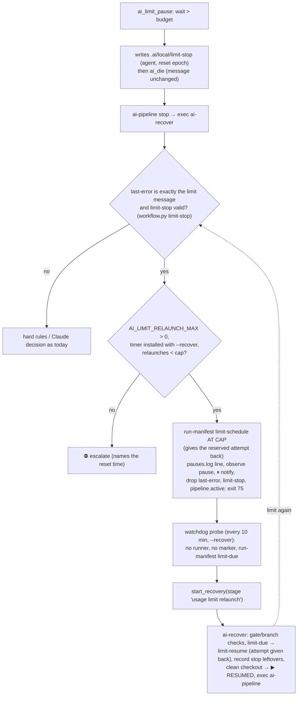

# Plan: Limits and plan stage: MC-01 part 1, DB-04, R15

## Assessment (verified at edc3dc6, 2026-10-17)
See `.ai/project-spec.md` "Verified against the code". In short: limit stops beyond the wait
budget escalate as a hard rule and nothing relaunches them; `ai-run --plan` and the nine-box
dashboard exist, but there is no `ai-plan` command, no read-only reference directories, no
detached start, no outcome/run-log record and a killed planning session looks idle; the PR step
can draft but never un-drafts and does not remember that it drafted.

## Architecture

### MC-01 part 1 — limit-only stop → scheduled relaunch (T001 helpers, T002 watchdog, T003 ai-recover, T004 dashboard)

- **Record (T001).** `ai_limit_pause` writes `.ai/local/limit-stop` (`<Agent> <reset epoch or 0>`,
  via a temp file and `mv`) just before its `ai_die`; the die message stays byte-identical (the
  existing hard-rule pattern and docs keep working). `workflow.py limit-stop` prints
  `<Agent> <relaunch epoch>` and exits 0 only when `.ai/local/last-error` holds exactly one line
  matching `^(Claude|Codex) usage limit: the reset is beyond the \d+s wait budget\. Rerun after
  it resets\.$`, `limit-stop` parses, names the same agent, and is not older than last-error by
  more than 120 s (a stale file from an earlier stop never qualifies). Relaunch epoch:
  `reset + 60` when the reset is in the future, `now + AI_LIMIT_RETRY` (default 1800) when it is
  0, `now` when it has passed. "Only reason" = the whole last-error is the limit message.
- **Schedule (T001).** New run-manifest actions, all atomic on `run.json` (fields optional, so
  existing manifests stay valid; a human `start` drops them; `clear-attempts`, called by
  `finish`, resets them): `limit-schedule AT CAP` (fails `usage limit: already relaunched N
  time(s) in this run` when `limit_relaunches >= CAP`; else `limit_relaunches += 1`,
  `limit_relaunch_at = AT`, `attempts = max(0, attempts - 1)`; prints the new count);
  `limit-due [NOW]` (prints AT and exits 0 when set and `AT <= NOW`, default `time.time()`; exit 1
  otherwise); `limit-resume` (drops `limit_relaunch_at`, `attempts = max(0, attempts - 1)`; prints
  the relaunch count); `limit-count`. New setting `AI_LIMIT_RELAUNCH_MAX` (0–9, default 2) in
  `RUN_SETTINGS`, `ai_config`'s key list and both lists in `ai-recover`.
- **Watchdog (T002).** Under its lock, before the incident logic: with `--recover`, no runner
  alive and no `pipeline.active` marker, it asks THIS host copy's `workflow.py run-manifest
  limit-due` (same trust path as the gate check in `start_recovery`); when due it calls
  `start_recovery(root, local, marker, stage='usage limit relaunch')` (generalised: the default
  crash last-error is written only for the crash stage). Refused → one `⛔ STOPPED, needs you: the
  usage-limit relaunch could not start: <reason>.` per AT (dedupe key `relaunch:<AT>` in
  `watchdog.json` `active`). Not due → nothing. The stall incident is skipped while
  `now < paused_until(local)` (ai-recover's pauses.log line carries the wait until AT). New flag
  `--timer-recovers`: exit 0 when `timer_status(root)` is installed and the service's ExecStart
  contains `"--recover"`, else 1 (one line on stdout).
- **ai-recover (T003).** After the plan-revision decision block and BEFORE the hard rules:
  (1) due relaunch: `run-manifest limit-due` exits 0 → `limit-resume`, notify
  `▶ RESUMED after the usage limit (relaunch k/cap): <branch>`, then the existing open-stage
  branch (resume) or record-stop-leftovers + clean-checkout check + `resume` (no Claude, no
  `AI_RECOVER_MAX` count). (2) limit-only stop: `limit-stop` exits 0 → when
  `AI_LIMIT_RELAUNCH_MAX` is 0 fall through to the hard rules (today); when
  `"$AI_BIN/ai-watchdog" "$AI_ROOT" --timer-recovers` fails → escalate `the usage limit resets
  around <time>, but no watchdog timer with --recover is installed to relaunch the run.` /
  `install it (ai-watchdog --install-timer --recover) or rerun ai-pipeline after the reset.`;
  `limit-schedule` fails (cap) → escalate `usage limit again after N relaunch(es) in this run.`;
  else schedule: append `pauses.log` line `<UTC> paused <AT-now>s: <Agent> usage limit relaunch
  (resume ~<a H:M>)`, `ai_observe pause "<Agent> limit · relaunch after <a H:M>"`, notify
  `⏸ PAUSED: <branch> stopped at a <Agent> usage limit during <stage>; relaunches by itself after
  <a H:M> (relaunch k/cap).`, remove last-error, `limit-stop` and `pipeline.active`, mark the stop
  announced (no ⛔ from `on_exit`), print one line and exit 75.
- **Dashboard (T004).** No live runner, no marker, observation `state: paused` → status
  `paused` (waiting for a relaunch), marker text keeps the note; ranks with the live paused runs.

### DB-04 — `ai-plan` (T005 read dirs, T006 command, T007 logging, T004 killed planning)
- **Read dirs (T005).** `ai-run --plan … --read-dir DIR` (repeatable, plan mode only; existing
  directory, resolved with `pwd -P`, refused when it contains `*`, `?`, `[`, `(`, `)`, a newline
  or a comma): each adds `--add-dir DIR` and the allow entry `Read(/DIR/**)` (an absolute DIR
  gives `Read(//abs/**)`, Claude Code's absolute-path form, as in `launch-plan.sh`). No Edit or
  Write outside `plan-allowlist`. The contract names them as read-only reference directories.
- **Command (T006).** `scripts/ai-plan PROMPT_FILE [--revision] [--model NAME]
  [--session-timeout S] [--knowledge-dir DIR] [--read-dir DIR]... [--detach]`: without
  `--detach` it execs `ai-run --plan …` (same process, so the dashboard and watchdog see an
  `ai-run` runner and nothing else changes). With `--detach`: prompt path made absolute, log
  `.ai/local/plan-<UTC stamp>.log`, `setsid "$AI_BIN/ai-run" --plan … </dev/null >log 2>&1 &`
  (a non-interactive shell's background job is not a group leader, so `setsid` execs without
  forking and `$!` is the runner's PID), then wait up to `AI_PLAN_ACK_SECONDS` (default 20) for
  `.ai/local/observation.json` to show `stage: planning` with `pid` equal to that PID (success:
  `Planning session started: pid N, log PATH`, exit 0), or for the child to exit (print the log's
  last lines, exit with its status), else `could not confirm …` exit 1 (the child keeps running).
  Installed by `setup-project` (list at workflow.py:306).
- **Logging (T007).** Outcome kind `plan` (`outcome plan RESULT MODEL SECONDS [TASKS]`, not in
  `outcomes_report`), written on success (`done`, task count) and from `on_exit` for a planning
  stop (`interrupted` 130/143, `timeout` 124/137 session code, else `stopped`), only with the
  gate intact. On success one run-log line (`ai_log planning "plan written: N tasks (<model>,
  <kind>)" PASS 'Plan left uncommitted for review'`); `.ai/run-log.md` is already in plan scope.
- **Killed planning (T004).** No runner, no marker, observation `stage: planning`,
  `state: active` → status `needs_you`, note `planning session ended without a plan (killed?)`,
  so the Plan box shows ✗ like a recorded `stop plan`.

### R15 — un-draft only pipeline-drafted PRs (T008 record, T009 pipeline)
- **Record (T008).** Host state per branch, beside the stage records: `binding_dir() /
  pr-draft-<sha256(branch)[:16]>.json` = `{"branch", "url", "how": "created"|"converted",
  "at"}` written atomically. Helper `pr-draft record URL HOW`, `pr-draft get` (prints the URL,
  exit 1 when none or unreadable/foreign: fails closed = "not ours"), `pr-draft clear`.
- **Pipeline (T009).** Draft reasons: `--draft` (the human's request: never recorded) versus
  the pipeline's policy (`unresolved` or disputes). Recorded when the pipeline creates the PR
  with `--draft` for policy, or converts an existing ready PR with `gh pr ready --undo` for policy
  (after the isDraft check confirms). When `make_draft=no` and the existing PR is a draft: if
  `pr-draft get` equals this PR's URL → `gh pr ready "$branch"`, confirm `isDraft == false`, clear
  the record, log it; a failure warns and keeps the record (the run still finishes; the summary
  says the PR is still a draft). No record or another URL → leave it draft and print
  `PR is a draft set outside the pipeline; left as draft.` An existing ready PR clears a stale
  record (a human un-drafted it).

## Phases / tasks
| Task | Item | What | Model |
| --- | --- | --- | --- |
| T001 | MC-01 | limit-stop record, run-manifest relaunch schedule, setting | opus |
| T002 | MC-01 | watchdog starts the due relaunch, `--timer-recovers`, stall skip | opus |
| T003 | MC-01 | ai-recover schedules instead of escalating; due path resumes | opus |
| T004 | MC-01, DB-04 | dashboard: waiting relaunch is paused, killed planning is a stop | sonnet |
| T005 | DB-04 | `ai-run --plan --read-dir` | sonnet |
| T006 | DB-04 | `scripts/ai-plan` with `--detach` | opus |
| T007 | DB-04 | planning sessions in the outcome log and run log | sonnet |
| T008 | R15 | host record of a pipeline-drafted PR | sonnet |
| T009 | R15 | PR step un-drafts only a recorded pipeline draft | sonnet |
| T010 | all | docs, flow chart and handoff audit | haiku |

## Risks
- A schedule left behind by a crash between `limit-schedule` and the exit: harmless (the watchdog
  relaunches at AT; the cap bounds it; a human start drops it).
- Watchdog not installed or installed without `--recover`: detected by `--timer-recovers`; the
  stop escalates as today. A timer removed after scheduling: nobody relaunches; the ⏸
  notification states the time, so the human can rerun. Accepted (no daemon, AD-4).
- Weekly limits: the relaunch may be days away; the run waits without a process (no lock held).
  A human start in between drops the schedule (`run-manifest start` rewrites the manifest).
- `limit-stop` lives in `.ai/local/` (agent-writable). It only selects between "schedule a
  relaunch of the approved run" and "escalate"; the relaunch runs under the same gate, branch and
  manifest checks as any recovery, and the cap bounds it. AD-5 holds: it authorizes nothing new.
- The un-draft rule cannot see a human who un-drafted and re-drafted between two pipeline runs
  (the record still says "ours"). Only a pipeline run that observes the PR ready clears it.
  Accepted limitation, documented.
- `setsid` behaviour: `--detach` relies on the background job not being a process-group leader;
  the test asserts the printed PID is the runner's (`/proc/PID/cmdline` names `ai-run`).

## Validation strategy
Targeted `python3 -m unittest discover -s tests -k <prefix>` per task, then `.ai/bin/ai-check`
(about 7 min; see the gate note in `.ai/tasks.md`). New test prefixes: `test_limit_relaunch_*`,
`test_dashboard_limit_relaunch_*`, `test_dashboard_plan_killed_*`, `test_plan_read_dir_*`,
`test_ai_plan_*`, `test_plan_outcome_*`, `test_pr_undraft_*`.

## Assumptions (unattended run; recorded instead of asked)
- The relaunch covers both agents' limit stops (the message and mechanism are shared); Zack's
  decision names Claude, and a Codex-only limit stop is the same "not a human problem".
- `AI_LIMIT_RELAUNCH_MAX` default 2 per human-started run; 0 restores today's escalation.
- A due relaunch needs auto-recovery on (`AI_AUTO_RECOVER=0` still escalates) and does not count
  against `AI_RECOVER_MAX`.
- A scheduled pause exits 75 (EX_TEMPFAIL) so callers never read it as success.
- "⛔ if the relaunch stops again": a later limit stop schedules again up to the cap, then ⛔; any
  other stop after a relaunch follows the normal recovery rules (which end in ⛔ when they give up).
- DB-04 "same allowlist": `ai-plan` uses `plan-allowlist` unchanged (it also allows
  `.ai/reviews/dispositions.md`, which the hand launcher lacked; it is a plan record).
- The Plan box already exists (nine boxes, goldens at 120/119/60 columns pass); DB-04 only adds
  the killed-session stop. A finished plan keeps today's view (Plan ✓, 📝 under Plan check) until
  the pipeline starts.
- R15: a PR drafted because the human passed `--draft` is never recorded, so never un-drafted.
- An un-draft failure does not stop the run (the PR is published; the record is kept for the next
  run); a draft conversion failure still stops as today.
