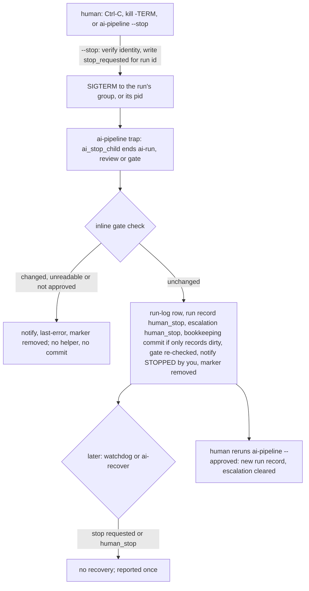

# Plan: Flow batch 11: run controls (RC-01: G1, G2, G3, G4–G7, G9, G11)

## Assessment (verified at 4fea72d, 2026-10-21; revised after plan review rounds 1 and 2)
See `.ai/project-spec.md`, "Verified against the code" and "Plan review round 1" / "round 2". In short:
nothing in the toolkit tells a human stop from a failure. An interrupt waits for the whole agent
session, then lands in `stop()`, which hands over to auto-recovery; a killed pipeline looks like a
crash to the watchdog. The only record of a run is one manifest per checkout without process or
time data, and a stop is described only in English text. Task edits by humans or apps need a
hand commit and have no lock.

The common shape of this batch (AD-4): small host records outside the checkout, one owner per
record, atomic writes, schema-versioned, read by the toolkit and by apps; the checkout's
`.ai/local` stays a convenience copy that is never trusted for authority. Round 1 added three
rules that hold for every task:
1. **Gate first** (P1): no shutdown path of the pipeline runs a checkout helper or commits before
   `ai_gate_check "$AI_APPROVED_GATE"` (the inline verifier) has passed in that path.
2. **Bound to the run** (P5): every lifecycle write names its run id and is checked under the host
   lock against the record, `current` and the caller's process identity.
3. **Every layer forwards** (P2): every long blocking call on the pipeline, runner and recovery
   paths is a background child the trap can end, publication commands included (round 2, P2);
   below the top process every layer is stopped by TERM.

Round 2 adds:
4. **One escalation writer per shutdown chain** (P13): a shutdown chain (e.g. `stop()` →
   `ai_die`) writes the escalation record once; the helper never lets a later `other` write
   replace a specific kind of the same run.

## Design

### Records and paths (all under `<binding dir>` = `<state root>/reviews/<16 hex>/` unless noted)
- `runs/<id>.json`, `runs/current` (the id, one line), `runs/.lock` (flock for read-modify-write of
  run and escalation records).
- `escalation.json` and `escalation-hint.json` (one at a time, beside `run.json`).
- Skip authorizations: `<state root>/skips/<64 hex>` (empty files; spec B13).
- Log of a detached run: `<checkout>/.ai/local/pipeline-<UTC stamp>-<8 hex>.log`.

### Run record, schema 1 (T301 helper, T315 lifecycle, T302 and T316 wiring)
```json
{"schema": 1, "id": "20261021T210000Z-12345-7", "kind": "pipeline", "checkout": "/abs/path",
 "branch": "fix/x", "base": {"ref": "origin/main", "sha": "<40 hex>"}, "argv": ["--approved", "..."],
 "launcher": "terminal", "log": null, "started": "2026-10-21T21:00:00Z",
 "process": {"pid": 12345, "pgid": 12345, "sid": 12000, "start_ticks": 987654},
 "resumes": 0, "stop_requested": null, "ended": null, "outcome": "running", "detail": ""}
```
- `id`: `<UTC %Y%m%dT%H%M%SZ>-<pid>-<seq>`, `seq` = 1 + the highest `seq` of the valid record
  names, chosen under `runs/.lock`, record created with `O_EXCL` (round 2, P15); retention keeps
  the 20 highest `seq`.
- `kind`: `pipeline` or `ai-run`. `base` null for `ai-run`. `argv` is the exact argument array
  (`orig_args` with the resolved `--knowledge-dir`, as the manifest).
- `outcome`: `running`, `finished`, `stopped` (stopped for a human), `human_stop`, `paused` (a
  usage-limit relaunch is scheduled), `crashed` (the watchdog found the process gone). "Ended"
  means any outcome other than `running` and `paused`.
- `stop_requested`: null or `{"at": ISO, "via": "ai-pipeline --stop" or "signal"}`.
- `detail`: at most 200 characters, one line, no `|`.
- T301 actions: `start KIND BRANCH BASE_REF BASE_SHA --pid PID -- ARGS…` (new record for the
  process PID, writes `current`, prunes to 20, prints the id), `current` (prints the id; exit 1
  when none), `show [ID]` (prints the JSON), `alive [ID]` (exit 0 when the recorded process
  exists with the same start ticks and is not a zombie).
- T315 lifecycle actions, each under `runs/.lock`, each refusing with exit 3 and no change when
  ID is not `current`, or the identity check fails ("not the owner"):
  - `own --run ID --pid PID --launcher NAME` (recovery): refuses a stop request or an ended
    record; replaces `process`, sets `launcher`, outcome `running`, `resumes` unchanged.
  - `resume --run ID --pid PID` (resumed pipeline): same refusals; replaces `process`,
    `resumes` + 1, outcome `running`. (T305 adds: clears the escalation record.)
  - `pause --run ID --pid PID` (outcome `paused`, not ended) and `end --run ID --pid PID OUTCOME
    [DETAIL]` (`finished`, `stopped`, `human_stop`, `crashed`): the record's process must be PID
    with PID's current start ticks; an ended record never changes again, so a first
    `human_stop` is kept.
  - `request-stop --run ID --via VIA [--expect-pid P --expect-ticks T]`: refuses an ended
    record and, with `--expect-*`, a record whose process is not that one.
  - `settle-stop --run ID` (also a Python function for `run-stop`): only with a stop request,
    the recorded process not alive and the record not ended → `human_stop`.
  - `stop-requested --run ID` (exit 0 when a stop is requested or the outcome is `human_stop`,
    1 when not, 3 when ID is not current).
  - The watchdog reads and writes the record itself (no checkout helper), with the same
    validation and the same id and liveness checks.
- Readers accept unknown extra fields; an unknown `schema` is treated as no record.

### G2: interrupts reach the child (T303 sessions, T304 review and gate, T317 runner and recovery, T318 pipeline, T323 publication)
`common.sh`:
```bash
# Run a long child (a timeout-wrapped session or gate, a toolkit script, a sleep) so a trapped
# INT/TERM can end it at once.
ai_run_child() { "$@" & AI_CHILD_PID=$!; local code=0; wait "$AI_CHILD_PID" || code=$?; AI_CHILD_PID=''; return "$code"; }
# From a trap: TERM the child, wait for it up to 30 s; idempotent; no-op without a child.
ai_stop_child() { … kill -TERM "$AI_CHILD_PID"; wait up to 30 s; return 1 if it is still alive … }
```
- T303: `ai-run` and `ai-recover` sessions; traps become `trap 'ai_stop_child; exit 130' INT` /
  `… 143' TERM`. T304: `ai-review` (both reviewers), `ai-check`, `ai_deps`. `ai-check`'s `| tee`
  becomes a logger on its own descriptor (`exec 7> >(tee "$log"); tee_pid=$!`), the validator
  `ai_run_child … >&7 2>&1`, then `exec 7>&-` and `wait "$tee_pid"`; the result keeps today's
  `PIPESTATUS` rule (the validator's code, the logger's when the logger failed) before the stamp
  is recorded (round 2, P14). T317: `ai-run`'s host gate (`ai-run` ~304), `ai-recover`'s host
  gate (~303), the sleep in `ai_limit_pause`. T318: the pipeline's `ai-run` (~288, ~332, ~552),
  `ai-review` (~369, ~509, ~566), `ai-check` (~265) and the push retry sleep (~253). T323: `git
  push` (~249), `git ls-remote` (~255) and every `gh` call of the PR stage (~679–719), through
  `ai_run_child` or `ai_run_capture FILE CMD…` (output to a file under `.ai/local`, because a
  trap does not run while the shell waits on a `$(…)`; round 2, P2).
- Exit codes are the child's. A background child of a non-interactive shell ignores SIGINT and
  cannot trap it, so below the top process only TERM (from `ai_stop_child`) ends a layer; a child
  script's exit code under a stop can be 130 or 143, and the parent's own trap decides the
  outcome.
- T318 and T323 must come after T306: without the pipeline trap a PID-only signal would end the
  pipeline at once and orphan its background child (spec B19).

### G1: human stop (T306 trap, T318 forwarding, T307 recovery and watchdog, T308 and T319 `--stop`)

- `ai_human_stop SIGNAL` (common.sh, used by ai-pipeline and ai-recover; idempotent through
  `AI_HUMAN_STOPPED`), in this order: `trap '' INT TERM`; `ai_stop_child`; if
  `AI_APPROVED_GATE` is unset (signal before the baseline) or `ai_gate_check "$AI_APPROVED_GATE"`
  fails → the gate-broken path: `ai_notify "⛔ STOPPED by you: $branch during $stage. Gate files
  changed or not yet approved: inspect them before rerunning."` (its log helper skips itself),
  `last-error` and `last-error.notified` by shell writes, `ai_drop_marker`, exit. Otherwise:
  `run-record request-stop --run "$AI_RUN_ID" --via signal` when none is recorded;
  `ai_log "$stage" "stopped by the human ($via)"` (skipped while armed); `run-record end
  --run "$AI_RUN_ID" --pid $$ human_stop`; `escalation write human_stop <stage>`;
  `ai_observe stop '' 'stopped by the human'`; the bookkeeping commit `chore(ai): record stop by
  the human` only when the dirty paths are a subset of state, run log and handoff and the child
  ended (skipped while armed), then `ai_gate_check` again (a failure from here on runs no helper);
  `last-error` = `stopped by the human during <stage>`; `AI_STOP_NOTIFIED=1`; `ai_notify "⛔
  STOPPED by you: $branch during $stage.<dirty clause> Rerun ai-pipeline --approved … to
  continue."` (dirty clause ` Partial work is kept uncommitted.`); `touch last-error.notified`;
  `ai_drop_marker`; exit 130 (INT) or 143 (TERM).
- `stop()`: the existing gate check stays first; only with `gate_ok=yes` it asks `run-record
  stop-requested --run "$AI_RUN_ID"` and, with a request, calls `ai_human_stop TERM`.
- `ai-pipeline` tracks the current stage in a shell variable set by `step` (no new observation).
- `--stop` (T308): bash dispatch at the top of `ai-pipeline` (before option parsing): `cd` into
  the checkout (`git -C CHECKOUT rev-parse --show-toplevel`), paths check, then `exec python3
  workflow.py run-stop [--wait S]`. `run-stop`: read `current` once and keep that id; no record or
  an ended one → exit 3 (`No run active in <checkout>.` or `Run <id> was already stopped by
  you.`); outcome `running`/`paused` and the process not alive → `request-stop`, `settle-stop`,
  completion (below), exit 0 (`Run <id> was not running (its process is gone); recorded as
  stopped by you, it will not be resumed.`, or `Cancelled the scheduled usage-limit relaunch of
  <id>.` when the manifest has `limit_relaunch_at`). Otherwise: identity check, `request-stop
  --expect-*`, identity check again, `os.killpg(pgid, SIGTERM)` when `pgid == pid` and it is not
  the caller's own group, else `os.kill(pid, SIGTERM)`; poll every 0.2 s up to `--wait`; ended
  with outcome `human_stop` → exit 0; ended without it → `settle-stop` + completion, exit 0;
  still alive → exit 4.
- Completion (T319): only for the kept id, only while it is still `current`, and only while
  `run-stop` holds `.ai/local/workflow.lock` with `flock -n` (held → another runner owns the
  checkout now: nothing written, the message says so): `escalation write human_stop <stage or
  unknown>`, remove `.ai/local/pipeline.active` only when it holds the recorded pid, write
  `last-error` and `last-error.notified` through the pinned `.ai/local`.

### G9: escalation record, schema 1 (T305 helper; T309 hints, T320 writes, T321 fix rounds)
```json
{"schema": 1, "kind": "task_blocked", "stage": "implementation", "run": "<run id>",
 "branch": "fix/x", "created": "ISO", "tasks": ["T305"],
 "evidence": {"last_error": "redacted excerpt", "review": ".ai/reviews/current.md",
              "findings": ["M1"], "log": "/abs/log or null"},
 "answers": [{"id": "retry_task", "label": "Return T305 to TODO with a note",
              "argv": [".ai/bin/ai-task", "retry", "T305", "--note", "{note}", "--commit"]},
             {"id": "resume", "label": "Start the run again with its approved arguments",
              "argv": [".ai/bin/ai-pipeline", "--approved", "..."]}]}
```
- `workflow.py escalation write KIND STAGE --run ID [--task ID]… [--finding ID]… [--review PATH]`
  (under `runs/.lock`; refuses with exit 3 when ID is not `current`), `hint KIND --run ID
  [--task ID]… [--finding ID]…` (host-side pending kind for that run, consumed by its next
  write), `show`, `clear`. A same-run `write` whose kind stays `other` after the refinement never
  replaces a record with a specific kind (round 2, P13). `write` reads `.ai/local/last-error` through the pinned `.ai/local`
  (regular file, ≤ 64 KB), redacts it (spec B10), takes the run log path from the run record and
  the recorded arguments from the manifest. `run-record start` and `resume` call `clear` (T305
  adds this to T315's actions).
- Answers per kind (always ending with `resume` when a manifest exists): `task_blocked` →
  per task `retry_task`, `skip_task`, `set_model`; `plan_review_limit` → `resume` (a human start
  resets the budget) and `resume_skip_plan_review`; `fix_round_limit` → `resume_more_rounds`
  (recorded args with `--max-fix-rounds` + 1, only when ≤ 5); `needs_human_question` →
  `review_plan` (`.ai/bin/ai-review --plan`, after answering in
  `.ai/reviews/plan-dispositions.md`; G8 is later work) then `resume`; `validation`, `crash`,
  `human_stop`, `usage_limit` (with `not_before` epoch when known), `other` → `resume`.
- Hints (T309): right before the stop at `plan_decision_check` (needs_human_question, finding ids
  from the questions), the `revision-reserve` refusals and the AI_SUPERVISE=0 plan review stop
  (plan_review_limit), `ai-run`'s "none can run" (task_blocked, the BLOCKED ids),
  `ensure_validated` (validation), `ai_limit_pause` beyond the budget (usage_limit).
- Writes (T320), each after a passing gate check in that path, one per shutdown chain (round 2,
  P13: the non-recovery `stop()` always ends in `ai_die`, and the first write consumes the hint;
  each write site sets `AI_ESCALATION_WRITTEN=1`, and `ai_die` writes only when it is unset):
  `stop()` non-recovery path, `ai_die` inside a pipeline (common.sh, best effort; only a direct
  `ai_die` without `stop()`), `ai-recover` `escalate()` (the watchdog's
  crash stage gives kind `crash`), the stand-alone `ai-run`'s `on_exit`. The watchdog itself only
  marks outcome `crashed` for a death it does not recover (T307); it writes no escalation record
  (that would need a second builder outside `workflow.py`). The fix-round limit (T321): written
  at `finish` when the loop broke at the limit.

### G7, G4, G5, G6: task commands (T310 lock and commit, T311 SKIPPED, T312 subcommands, T322 reauthorize)
- `ai-task` mutating forms: `set ID STATUS --commit`, `retry ID --note TEXT [--commit]`, `model ID
  MODEL [--commit]`, `skip ID --reason TEXT [--commit]`, `skip ID --reauthorize`. Shared bash
  function `task_change`: lock `.ai/local/workflow.lock` on fd 9 with `flock -n` (held → exit 75),
  branch check (not detached, not protected), with `--commit` a clean checkout first, run the
  helper, `ai_helper tasks check` (failure → restore the saved bytes, exit 1), then with
  `--commit` `git commit --only -m MSG -- .ai/tasks.md` and a clean check (failure → "changed but
  not committed", exit 1, nothing reverted). Messages: `chore(ai): set T305 to TODO (ai-task)`,
  `chore(ai): return T305 to TODO (ai-task)`, `chore(ai): note on T305 (ai-task)`, `chore(ai):
  set T305 model to opus (ai-task)`, `chore(ai): skip T305 (ai-task)`.
- Text arguments: one line, 1–500 characters, no control characters, no backticks.
- SKIPPED (T311): `tasks()` accepts it; it satisfies dependencies only with a matching
  authorization (spec B13; else `T…: SKIPPED without a host skip record (use ai-task skip, or
  ai-task skip ID --reauthorize on another host)`); `next` skips it; `complete` = every task DONE
  or SKIPPED; `untouched` and `newly-done` unchanged (DONE only); `counts`/`progress` count DONE
  only; `tasks set` refuses SKIPPED; the planning DONE-block guard covers SKIPPED blocks;
  `pr-body` adds "Skipped tasks: T… (reason)". `workflow.py tasks skip ID REASON` (refuses DONE,
  IN_PROGRESS, SKIPPED and a task an unfinished task depends on) writes the status, the `Skipped
  (DATE, ai-task skip): REASON` line under `### Result / notes` and the authorization.
- Reauthorize (T322): `workflow.py tasks skip-reauthorize ID` parses the queue with the skip
  check off, requires `Status: SKIPPED` and exactly one `Skipped (…)` line, creates the
  authorization, then runs the normal `tasks check`. No queue change, no commit.

### G11: `--detach` (T313, systemd only)
Bash dispatch at the top of `ai-pipeline`: `--detach` must be first; the rest must contain
`--approved`; `systemd-run` must be executable (else exit 1: `--detach needs systemd-run; run
ai-pipeline in a terminal or a service instead.`). Name `pipeline-<stamp>-<hex>.log`, which
`exec-logged` accepts from T324 on (today its `EXEC_LOG_NAME` allows only `plan-…`; round 2,
P12).
`systemd-run --user --collect --quiet --service-type=exec --unit=ai-pipeline-<base name>-<epoch>
--working-directory=<checkout> --setenv=…(PATH, XDG_CONFIG_HOME, XDG_STATE_HOME, AI_*) --setenv=
AI_LAUNCHER=detach-systemd --setenv=AI_RUN_LOG=<abs log> -- python3 -I <AI_BIN>/lib/workflow.py
exec-logged <name> -- <AI_BIN>/ai-pipeline <args>`. Then poll `run-record show` up to
`AI_PLAN_ACK_SECONDS` for a record started after the launch whose `log` is this log; print
`Pipeline started: pid N, log PATH`, `Follow: tail -f PATH`, `Stop: <AI_BIN>/ai-pipeline --stop
<checkout>`; not confirmed → exit 1 with the log's last lines, the service left running.

## Task map (queue order)
| Task | Gap | Model | What |
| --- | --- | --- | --- |
| T301 | G3 | opus | run record helper: schema, start, show, alive, host lock, retention |
| T315 | G3 | opus | run record lifecycle bound to the run id and process identity |
| T305 | G9 | opus | escalation record helper, redaction, answers, cleared by start and resume |
| T302 | G3 | opus | ai-pipeline records: required start, resume, finish, ai_die (gate first) |
| T316 | G3 | opus | ai-recover owns the run early; stand-alone ai-run record and order |
| T303 | G2 | opus | `ai_run_child`/`ai_stop_child`; ai-run and ai-recover sessions |
| T304 | G2 | opus | the same for ai-review, ai-check and dependency setup |
| T317 | G2 | opus | runner and recovery host gates and limit sleeps |
| T306 | G1 | opus | ai-pipeline INT/TERM trap, gate-first human stop, tamper tests |
| T318 | G2 G1 | opus | pipeline children and sleeps forwarded; PID-only stop at every stage |
| T323 | G2 G1 | opus | publication commands forwarded (git push, ls-remote, gh); PID-only stop tests |
| T307 | G1 | opus | ai-recover and the watchdog never resume a human stop |
| T308 | G1 | opus | `ai-pipeline --stop`: dispatch, identity, SIGTERM, wait, exit codes |
| T319 | G1 | opus | `--stop` completion bound to its run; relaunch cancel; recovery stop; races |
| T309 | G9 | sonnet | escalation hints at the producers |
| T320 | G9 | opus | escalation writes at every stop for a human (gate first), clearing |
| T321 | G9 | sonnet | fix-round limit record and plan kinds end to end |
| T310 | G7 | opus | ai-task lock and `--commit` |
| T311 | G6 | opus | SKIPPED status and the host-wide skip authorization |
| T312 | G4 G5 G6 | opus | `ai-task retry`, `model`, `skip` |
| T322 | G6 | opus | `ai-task skip ID --reauthorize` |
| T324 | G11 | sonnet | `exec-logged` accepts `pipeline-…` log names (both prefixes tested) |
| T313 | G11 | opus | `ai-pipeline --detach` (systemd-run only) and its stop test |
| T314 | docs | haiku | README, docs/workflow.md, flow chart audit, mission-control handoff note |

## Risks
- Trap ordering in bash: a trap runs after the foreground child returns. T303, T304, T317 and
  T318 make every long child a background child waited with `wait`, so the trap runs at once;
  T318 tests a PID-only signal in each long stage (session, review, gate, dependency setup,
  retry sleep), T323 in the publication commands. Left in the foreground (short, local): helper
  calls and `git commit`; a commit hook that blocks still delays the trap, and a push hook can
  outlive the `git push` that T323 ends (spec B21).
- Signals ignored on entry: a background child of a non-interactive shell cannot trap SIGINT;
  hence TERM between layers and SIGTERM from `--stop` (B2).
- Gate tampering during a stop (P1): T306's tests replace the checkout's `.ai/bin/lib/workflow.py`
  from the fake session and assert it never runs on the stop paths.
- Ownership races (P5): T315 tests the helper interleavings, T319 the command-level one (run B
  starts before A's stopper finishes).
- Batch 10 conflicts: `scripts/ai-run` gets one-word changes at the session and gate calls and
  the traps, plus the record calls after the traps; `ai-pipeline` gets the dispatch at the top,
  traps, the record and escalation calls and `ai_run_child` prefixes; nothing near line 478 (plan
  review entry) changes.
- Lock interplay: `--stop` never waits for the checkout lock (the pipeline holds it) and writes
  local completion records only when `flock -n` gets it; `ai-task`'s mutating forms never wait
  for it.
