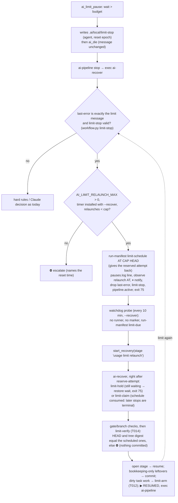

# Plan: Limits and plan stage: MC-01 part 1, DB-04, R15

## Assessment (verified at edc3dc6, 2026-10-17)
See `.ai/project-spec.md` "Verified against the code". In short: limit stops beyond the wait
budget escalate as a hard rule and nothing relaunches them; `ai-run --plan` and the nine-box
dashboard exist, but there is no `ai-plan` command, no read-only reference directories, no
detached start, no outcome/run-log record and a killed planning session looks idle; the PR step
can draft but never un-drafts and does not remember that it drafted.

## Architecture

### MC-01 part 1 — limit-only stop → scheduled relaunch (T001 helpers, T002 watchdog, T003 ai-recover, T004 dashboard)

- **Record (T001).** `ai_limit_pause` writes `.ai/local/limit-stop` (`<Agent> <reset epoch or 0>`,
  via a temp file and `mv`) just before its `ai_die`; the die message stays byte-identical (the
  existing hard-rule pattern and docs keep working). `workflow.py limit-stop` prints
  `<Agent> <relaunch epoch>` and exits 0 only when `.ai/local/last-error` holds exactly one line
  matching `^(Claude|Codex) usage limit: the reset is beyond the \d+s wait budget\. Rerun after
  it resets\.$`, `limit-stop` parses, names the same agent, and is not older than last-error by
  more than 120 s (a stale file from an earlier stop never qualifies). Relaunch epoch:
  `reset + 60` when the reset is in the future, `now + AI_LIMIT_RETRY` (default 1800) when it is
  0, `now` when it has passed. "Only reason" = the whole last-error is the limit message.
- **Schedule (T001).** New run-manifest actions, all atomic on `run.json` (fields
  `limit_relaunches`, `limit_relaunch_at`, `limit_head`, `limit_resume` optional, so existing
  manifests stay valid; a human `start` drops them; `clear-attempts`, called by `finish`, resets
  them): `limit-schedule AT CAP HEAD`, `limit-due [NOW]` and `limit-at` (read only, watchdog),
  `limit-hold [NOW]`, `limit-claim [NOW]`, `limit-verify HEAD` / `limit-arm HEAD` /
  `limit-armed HEAD` / `limit-disarm`, `limit-count`; exact semantics in T001 and "Relaunch
  schedule lifecycle" below (T012 extends the verify/arm family to the tree digest). New setting
  `AI_LIMIT_RELAUNCH_MAX` (0–9, default 2) in `RUN_SETTINGS`, `ai_config`'s key list and both
  lists in `ai-recover`. `limit-stop` is written by `workflow.py limit-stop-write` through the
  pinned `.ai/local` descriptor and `write_record` (exclusive `O_NOFOLLOW|O_NONBLOCK` temp,
  `os.replace` on the descriptor), never by a shell redirection (P6).
- **Relaunch schedule lifecycle (plan review round 1, P1–P3).** The schedule has three states
  and every `ai-recover` decides on it right after `reserve-attempt` and the settings restore,
  before any escalation can run:
  - *pending* (`AT > now`): `limit-hold` gives the reservation back; ai-recover restores the
    wait (removes last-error, limit-stop, the stale marker; appends the same `pauses.log` line
    the scheduling path writes; `observe relaunch`; ⏸ again) and exits 75. This makes
    scheduling idempotent across a kill between `limit-schedule` and the cleanup: the
    watchdog's crash recovery for the dead marker, or any early recovery, never schedules twice
    (cap unchanged) and never retries before the reset. The watchdog does not depend on that
    restoration: its stall rule reads the pending schedule from the manifest itself (plan
    review round 3, P2; see "Watchdog").
  - *due* (`AT <= now`): `limit-claim` consumes it in the same write that gives the attempt
    back. From here every stop is that relaunch's own terminal ⛔ (or the normal recovery rules
    after the resume); no later probe sees a due schedule, so a branch switch, a changed gate or
    `AI_AUTO_RECOVER=0` produce exactly one ⛔ and no launch loop.
  - *none*: today's behaviour.
  *Preserved task work (T011).* A limit stop inside an implementation session leaves its edits
  (task IN_PROGRESS, source). The claimed relaunch does not commit them and does not escalate:
  when the tree is dirty after recording the bookkeeping leftovers and HEAD still equals
  `limit_head`, it arms the manifest (`limit_resume = HEAD`). The resumed `ai-pipeline` and
  `ai-run` accept exactly that tree at their start-from-clean checks (ai-pipeline ~123,
  `reconcile_disputes` ~326 with no re-check, ai-run ~148), only on a resume, and ai-run
  consumes the arm before its first session. The normal session reconciles the work ("Reconcile
  interrupted work first"); DONE still needs `ai-check`, the checkpoint guard and
  committed-matches-worktree, as for any task. Chosen over a recovery WIP commit (would commit
  unvalidated content) and over the Claude decision session (the reviewer's and the decision's
  point: a limit is not a human problem). HEAD moved since the stop → ⛔.
- **Preserved-work resume (plan review round 2 redesign, T012 + T011).** Round 1 (P3) and
  round 2 (P3, P9) both found gaps in the preserved-work exception, so the area is specified
  as a whole instead of patched per symptom:
  - *Binding.* The exception admits a TREE, not a commit. `workflow.py worktree-digest`
    (T012) is the existing `tree_snapshot(root)` (workflow.py ~2245: HEAD, the staged diff,
    every non-ignored path outside `.ai/local/` with kind, mode and bytes or link target,
    submodules recursively through their own HEAD, index and working contents, uninitialised
    submodules walked on the filesystem). No second digest implementation (plan review round
    3, P10: a digest that records a gitlink as `dir` misses edits and commits inside a
    submodule, which change neither the parent HEAD nor its index). Tracked bookkeeping
    (`.ai/state.md`, `.ai/run-log.md`, `.ai/handoff.md`, `.ai/reviews/`) is INCLUDED.
    `limit-schedule AT CAP` records `limit_head` and `limit_tree` computed by the helper
    itself; `limit-verify` (no argument) recomputes both and compares them with the recorded
    ones (read only); `limit-arm` (no argument) recomputes both and arms
    (`limit_resume = {head, tree}`) only on an exact match; `limit-armed` (no argument)
    recomputes and compares at every acceptance site. Any difference (a human edit, an added
    file, a staged change, a commit, a submodule change) → ⛔ with `nothing was committed.`,
    the arm is not set and the tree is left as it is.
  - *Verification point (plan review round 3 redesign, T014).* Round 3 (P9, P10) found the
    verification placed after checkout mutations and the digest incomplete, so the relaunch's
    acceptance of the checkout is now ONE contract with one verification site:
    1. `limit-schedule` records HEAD and the tree digest AFTER the stop's bookkeeping was
       written and BEFORE ai-recover's own leftovers commit (T003 schedules before the hard
       rules), so the recorded digest is exactly the checkout the relaunch must find. After
       scheduling, the host writes nothing tracked: ai-recover's cleanup and the watchdog touch
       only `.ai/local/` and host state.
    2. The claimed relaunch verifies first: `relaunch_verify` (one shell function in
       ai-recover, called at exactly one site) runs `run-manifest limit-verify` right after the
       gate and branch checks and BEFORE the plan-revision decision block, the open-stage
       resume, the leftovers commit and anything else that reads the checkout to decide. A
       mismatch escalates with the helper's reason (`the branch moved to another commit while
       the usage-limit relaunch waited; nothing was committed.` for HEAD, `the checkout changed
       while the usage-limit relaunch waited; nothing was committed.` for the tree) and the
       checkout is left exactly as found: no commit, no stash, no checkout, no resume, no
       session. This covers the three cases the round 2 design missed: a human edit confined to
       bookkeeping files (previously committed by the leftovers block, which then resumed a
       clean checkout unverified), a clean checkout whose HEAD moved (previously resumed), and
       an in-scope human edit while a triage or plan-revision stage is open (previously
       resumed and completed by the pipeline).
    3. Only after a passing verification does the relaunch transform the checkout, and only
       in these host-owned transitions of the verified tree: an open stage → `resume` (the
       stage's own leftovers, verified identical); a dirty tree confined to `.ai/state.md`,
       `.ai/run-log.md`, `.ai/handoff.md` → the existing leftovers commit (the stopped run's own
       stop records) → clean → `resume`; a dirty tree with anything else → `limit-arm`
       (recomputes; equal because nothing touched the checkout since the verification, under
       the lock) → `resume`; a clean tree → `resume`. `limit-arm` failing here is an internal
       inconsistency and escalates with the same wording; it is no longer the first check.
    4. `limit-armed` at ai-pipeline's and ai-run's acceptance sites (T011) recomputes against
       `limit_resume` in the same exec chain under the same lock, so a passing arm passes there.
  - *What the resumed run does with the tree.* ai-pipeline does not skip ai-run while the tree
    is armed (`tasks complete` at ai-pipeline ~499 is not consulted then). ai-run consumes the
    arm before any session and asks `tasks newly-done HEAD` (T012: IDs DONE in the working
    queue but not DONE in HEAD's queue): exactly one → *armed checkpoint*: the existing
    post-task DONE path (full `ai-check`, failure returns the task to IN_PROGRESS and stops;
    tier-1 commit with `checkpoint-guard`, stamp verify, `committed-matches-worktree`; runner
    bookkeeping commit), refactored into one function used by both, then the loop continues
    (final validation and handoff when nothing is left); none → the normal session on
    `tasks next` (IN_PROGRESS first); more than one → `ai_die` (the arm is already gone, so
    the next recovery takes the normal rules).
- **R15 revocation (plan review round 2, P4).** Pipeline ownership is revoked durably or the run
  stops: records live in their own host directory `binding_dir()/pr-draft/`; `pr-draft clear`
  unlinks, fsyncs the directory and confirms the file is gone (any other `OSError` → exit 1
  naming the path); `pr-draft take URL` consumes a matching record the same way and prints its
  HOW. A `--draft` run clears at the start of the PR step, before any `gh` change, and a failed
  clear stops `pull request` with a reason ai-recover treats as a hard rule (⛔, names the file
  to delete). The un-draft path takes the record BEFORE `gh pr ready`; a failed take leaves the
  PR draft (warning); a failed ready re-records it (best effort; a lost record fails closed).
- **Detached log (plan review round 2, P8).** `ai-plan --detach` never redirects to a path:
  it launches `setsid python3 -I "$AI_BIN/lib/workflow.py" exec-logged NAME -- "$AI_BIN/ai-run"
  --plan …` (T013), which pins `.ai/local` with `local_dir_fd`, creates NAME
  (`plan-<UTC stamp>-<8 random hex>.log`, validated) with `O_CREAT|O_EXCL|O_NOFOLLOW|
  O_NONBLOCK`, checks it is a regular file, `dup2`s it to stdout/stderr and `execv`s the runner
  (same PID). An existing name (symlink, FIFO, file) fails without touching it, and two launches
  never share a log.
- **Watchdog (T002).** Under its lock, before the incident logic: with `--recover`, no runner
  alive and no `pipeline.active` marker, it asks THIS host copy's `workflow.py run-manifest
  limit-at` (same trust path as the gate check in `start_recovery`) for the scheduled AT; when
  `AT <= now` it calls `start_recovery(root, local, marker, stage='usage limit relaunch')`
  (generalised: the default crash last-error is written only for the crash stage). Refused →
  one `⛔ STOPPED, needs you: the usage-limit relaunch could not start: <reason>.` per AT
  (dedupe key `relaunch:<AT>` in `watchdog.json` `active`). `AT > now` → nothing launched and
  the stall incident is skipped: the stall rule holds only while
  `now >= max(paused_until(local), pending AT)`, so a pending host schedule suppresses the
  stall alarm by itself, whether or not `.ai/local/pauses.log` still carries the wait (plan
  review round 3, P2: a kill between `limit-schedule` and the pauses.log append, restored by
  `limit-hold`, left no pause entry). The `pauses.log` line stays for the hung rule's quiet
  time and as the dashboard's history. New flag
  `--timer-recovers`: exit 0 when `timer_status(root)` is installed and the service's ExecStart
  contains `"--recover"`, else 1 (one line on stdout).
- **ai-recover (T003).** Right after `reserve-attempt` and the settings: `limit-hold` /
  `limit-claim` (lifecycle above). A claimed relaunch runs `relaunch_verify` right after the
  gate and branch checks ("Verification point" above): mismatch → ⛔, nothing touched. After
  the plan-revision decision block and BEFORE the hard rules: (1) claimed relaunch → notify
  `▶ RESUMED after the usage limit (relaunch k/cap): <branch>`, then the transitions of the
  verified tree: the existing open-stage branch (resume), or record-stop-leftovers
  (bookkeeping-only) + `resume`, or a dirty tree armed + `resume`, or clean + `resume` (no
  Claude, no `AI_RECOVER_MAX` count). (2) limit-only stop: `limit-stop` exits 0 → when
  `AI_LIMIT_RELAUNCH_MAX` is 0 fall through to the hard rules (today); when
  `"$AI_BIN/ai-watchdog" "$AI_ROOT" --timer-recovers` fails → escalate `the usage limit resets
  around <time>, but no watchdog timer with --recover is installed to relaunch the run.` /
  `install it (ai-watchdog --install-timer --recover) or rerun ai-pipeline after the reset.`;
  `limit-schedule` fails (cap) → escalate `usage limit again after N relaunch(es) in this run.`;
  else schedule: append `pauses.log` line `<UTC> paused <AT-now>s: <Agent> usage limit relaunch
  (resume ~<a H:M>)`, `ai_observe relaunch AT "<Agent> limit · relaunch after <a H:M>"`, notify
  `⏸ PAUSED: <branch> stopped at a <Agent> usage limit during <stage>; relaunches by itself after
  <a H:M> (relaunch k/cap).`, remove last-error, `limit-stop` and `pipeline.active`, mark the stop
  announced (no ⛔ from `on_exit`), print one line and exit 75.
- **Dashboard (T004).** No live runner, no marker, no newer last-error, observation
  `state: paused` WITH `relaunch_at` (written only by `observe relaunch`, dropped by every other
  action) → status `paused` (waiting for a relaunch), marker text keeps the note; ranks with the
  live paused runs. A plain `paused` (an in-process `ai_limit_pause` wait whose runner was
  killed) is no evidence: it falls through to the planning-stop rule or today's idle (P5).

### DB-04 — `ai-plan` (T005 read dirs, T006 command, T007 logging, T004 killed planning)
- **Read dirs (T005).** `ai-run --plan … --read-dir DIR` (repeatable, plan mode only; existing
  directory, resolved with `pwd -P`, refused when it contains `*`, `?`, `[`, `(`, `)`, a newline
  or a comma): each adds `--add-dir DIR` and the allow entry `Read(/DIR/**)` (an absolute DIR
  gives `Read(//abs/**)`, Claude Code's absolute-path form, as in `launch-plan.sh`). No Edit or
  Write outside `plan-allowlist`. The contract names them as read-only reference directories.
- **Command (T006).** `scripts/ai-plan PROMPT_FILE [--revision] [--model NAME]
  [--session-timeout S] [--knowledge-dir DIR] [--read-dir DIR]... [--detach]`: without
  `--detach` it execs `ai-run --plan …` (same process, so the dashboard and watchdog see an
  `ai-run` runner and nothing else changes). With `--detach`: prompt path made absolute, log
  `.ai/local/plan-<UTC stamp>-<8 random hex>.log` created by T013's `exec-logged` (see
  "Detached log" above; never a shell redirection to the log path), `setsid python3 -I …
  exec-logged NAME -- "$AI_BIN/ai-run" --plan … </dev/null &` (a non-interactive shell's
  background job is not a group leader, so `setsid` execs without forking, and `exec-logged`
  execs the runner, so `$!` is the runner's PID), then wait up to `AI_PLAN_ACK_SECONDS` (default 20) for
  `.ai/local/observation.json` to show `stage: planning` with `pid` equal to that PID (success:
  `Planning session started: pid N, log PATH`, exit 0), or for the child to exit (print the log's
  last lines, exit with its status), else `could not confirm …` exit 1 (the child keeps running).
  Installed by `setup-project` (list at workflow.py:306).
- **Logging (T007).** Outcome kind `plan` (`outcome plan RESULT MODEL SECONDS [TASKS]`, not in
  `outcomes_report`), written on success (`done`, task count) and from `on_exit` for a planning
  stop (`interrupted` 130/143, `timeout` 124/137 session code, else `stopped`), only with the
  gate intact. On success one run-log line (`ai_log planning "plan written: N tasks (<model>,
  <kind>)" PASS 'Plan left uncommitted for review'`); `.ai/run-log.md` is already in plan scope.
- **Killed planning (T004).** No runner, no marker, observation `stage: planning`,
  `state` `active` or `paused` → status `needs_you`, note `planning session ended without a plan (killed?)`,
  so the Plan box shows ✗ like a recorded `stop plan`.

### R15 — un-draft only pipeline-drafted PRs (T008 record, T009 pipeline)
- **Record (T008).** Host state per branch, beside the stage records: `binding_dir() /
  pr-draft-<sha256(branch)[:16]>.json` = `{"branch", "url", "how": "created"|"converted",
  "at"}` written atomically. Helper `pr-draft record URL HOW`, `pr-draft get` (prints the URL,
  exit 1 when none or unreadable/foreign: fails closed = "not ours"), `pr-draft clear`.
- **Pipeline (T009).** Draft reasons: `--draft` (the human's request: never recorded) versus
  the pipeline's policy (`unresolved` or disputes). Recorded when the pipeline creates the PR
  with `--draft` for policy, or converts an existing ready PR with `gh pr ready --undo` for policy
  (after the isDraft check confirms). When `make_draft=no` and the existing PR is a draft: if
  `pr-draft take` of this PR's URL succeeds (record consumed first, round 2 P4) → `gh pr ready
  "$branch"`, confirm `isDraft == false`, log it; a failure warns and keeps the record (the run still finishes; the summary
  says the PR is still a draft). No record or another URL → leave it draft and print
  `PR is a draft set outside the pipeline; left as draft.` An existing ready PR clears a stale
  record (a human un-drafted it). A run with `--draft` clears the record whatever the PR's state:
  the human's explicit draft intent revokes pipeline ownership (P4).

## Phases / tasks
| Task | Item | What | Model |
| --- | --- | --- | --- |
| T001 | MC-01 | limit-stop record, run-manifest relaunch schedule, setting | opus |
| T002 | MC-01 | watchdog starts the due relaunch, `--timer-recovers`, stall skip | opus |
| T003 | MC-01 | ai-recover schedules instead of escalating; hold/claim lifecycle; due path resumes | opus |
| T012 | MC-01 | preserved-work binding: tree digest (= `tree_snapshot`), verify/arm on the exact tree, `tasks newly-done` | opus |
| T014 | MC-01 | relaunch binding verification contract: one verification site before any mutation, host transitions, submodule and bookkeeping regressions | opus |
| T011 | MC-01 | relaunch continues preserved task work once (armed resume; DONE → armed checkpoint) | opus |
| T004 | MC-01, DB-04 | dashboard: waiting relaunch is paused, killed planning is a stop | sonnet |
| T005 | DB-04 | `ai-run --plan --read-dir` (permission boundary) | opus |
| T013 | DB-04 | `workflow.py exec-logged`: exclusive log in pinned `.ai/local`, exec on its fd | opus |
| T006 | DB-04 | `scripts/ai-plan` with `--detach` | opus |
| T007 | DB-04 | planning sessions in the outcome log and run log | sonnet |
| T008 | R15 | host record of a pipeline-drafted PR | sonnet |
| T009 | R15 | PR step un-drafts only a recorded pipeline draft (durable revocation) | opus |
| T010 | all | docs, flow chart and handoff audit | haiku |

## Risks
- A crash between `limit-schedule` and the exit leaves `pipeline.active` with a dead PID, so the
  watchdog starts crash recovery at once: `limit-hold` restores the wait (no second schedule, no
  early retry; plan review round 1 P2). A relaunch that escalates after `limit-claim` is
  terminal (P1). Residual: a kill between `reserve-attempt` and `limit-claim` in the relaunched
  ai-recover leaves the schedule due with no marker, so the next probe (10 min later) relaunches
  once more; that is a retry of the same relaunch, not a new one (the relaunch count does not
  change) and needs an external kill in a window of two helper calls each time. Accepted.
- Preserved task work (T011/T012/T014) is admitted only on a resume, for the exact tree (HEAD,
  index, worktree, submodules) recorded when the stop was scheduled, once; it is the session's
  own uncommitted output, exactly what the in-process `ai_limit_pause` wait would have
  continued with, and it is validated before any commit. The relaunch verifies the whole
  checkout once, before it commits, resumes or arms anything, so a change during the wait
  (days for a weekly limit), in a tracked file, a bookkeeping file, an untracked file, the
  index, HEAD or a submodule, escalates with the checkout exactly as found; nothing is
  absorbed. Residual: an edit that restores byte-identical content is indistinguishable, and
  harmless; ignored paths (installed dependencies) are outside the digest, as for
  `tree_snapshot` today.
- Watchdog not installed or installed without `--recover`: detected by `--timer-recovers`; the
  stop escalates as today. A timer removed after scheduling: nobody relaunches; the ⏸
  notification states the time, so the human can rerun. Accepted (no daemon, AD-4).
- Weekly limits: the relaunch may be days away; the run waits without a process (no lock held).
  A human start in between drops the schedule (`run-manifest start` rewrites the manifest).
- `limit-stop` lives in `.ai/local/` (agent-writable). It only selects between "schedule a
  relaunch of the approved run" and "escalate"; the relaunch runs under the same gate, branch and
  manifest checks as any recovery, and the cap bounds it. AD-5 holds: it authorizes nothing new.
- The un-draft rule cannot see a human who un-drafted and re-drafted between two pipeline runs
  (the record still says "ours"). Only a pipeline run that observes the PR ready clears it.
  Accepted limitation, documented.
- `setsid` behaviour: `--detach` relies on the background job not being a process-group leader;
  the test asserts the printed PID is the runner's (`/proc/PID/cmdline` names `ai-run`).

## Validation strategy
Targeted `python3 -m unittest discover -s tests -k <prefix>` per task, then `.ai/bin/ai-check`
(about 7 min; see the gate note in `.ai/tasks.md`). New test prefixes: `test_limit_relaunch_*` (incl. `test_limit_relaunch_preserved_*`,
`test_limit_relaunch_binding_*`, `test_limit_relaunch_verify_*`), `test_exec_logged_*`,
`test_dashboard_limit_relaunch_*`, `test_dashboard_plan_killed_*`, `test_plan_read_dir_*`,
`test_ai_plan_*`, `test_plan_outcome_*`, `test_pr_undraft_*`.

## Assumptions (unattended run; recorded instead of asked)
- The relaunch covers both agents' limit stops (the message and mechanism are shared); Zack's
  decision names Claude, and a Codex-only limit stop is the same "not a human problem".
- `AI_LIMIT_RELAUNCH_MAX` default 2 per human-started run; 0 restores today's escalation.
- A due relaunch needs auto-recovery on (`AI_AUTO_RECOVER=0` still escalates) and does not count
  against `AI_RECOVER_MAX`.
- A scheduled pause exits 75 (EX_TEMPFAIL) so callers never read it as success.
- "⛔ if the relaunch stops again": a later limit stop schedules again up to the cap, then ⛔; any
  other stop after a relaunch follows the normal recovery rules (which end in ⛔ when they give up).
- DB-04 "same allowlist": `ai-plan` uses `plan-allowlist` unchanged (it also allows
  `.ai/reviews/dispositions.md`, which the hand launcher lacked; it is a plan record).
- The Plan box already exists (nine boxes, goldens at 120/119/60 columns pass); DB-04 only adds
  the killed-session stop. A finished plan keeps today's view (Plan ✓, 📝 under Plan check) until
  the pipeline starts.
- R15: a PR drafted because the human passed `--draft` is never recorded, so never un-drafted.
- An un-draft failure does not stop the run (the PR is published; the record is kept for the next
  run); a draft conversion failure still stops as today.
