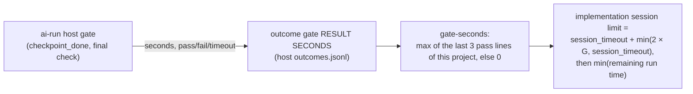
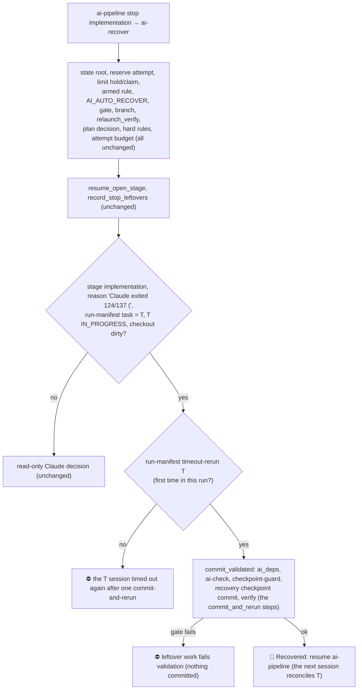

# Plan: Flow batch 7: FL-28, FL-29, FL-30, FL-31

## Assessment (verified at 1423b60, 2026-10-18)
See `.ai/project-spec.md`, "Verified against the code". In short:
- FL-28 is fully open on both halves.
- FL-29 is half done: the allowlist and the basic prompt line exist; the exact-form wording and the
  host-side mode restore are missing.
- FL-30's parser is done; only a regression for the incident and a fuller prompt example remain.
- FL-31 is open. `run_parallel.py` is silent until the end and prints nothing on a stop; every
  `ToolkitTest` rebuilds its project from scratch.

## Architecture

### FL-28 part 1: gate allowance (T022 helper, T023 runner)

- **Record (T022).** `workflow.py outcome gate RESULT SECONDS`: RESULT is `pass|fail|timeout`
  and SECONDS a non-negative int, otherwise a usage error. The record holds `kind: gate`, project,
  branch, result and seconds. `outcomes_report` (`ai-status --outcomes`) ignores the kind; check
  this and keep its output unchanged. `gate-seconds` reads the log with the existing
  `read_outcomes` and `decode_outcome_lines` (torn lines ignored) and prints the largest seconds
  among the last 3 `pass` lines of `project_name()`, or `0`. It always exits 0 on a readable or
  missing log, and exits 1 on an unsafe state root, as `outcome` does.
- **Runner (T023).** `ai-run` times each host `ai-check` (`SECONDS` before and after) in
  `checkpoint_done` and in the final check. After `ai_guard_verify` passes (never a helper after a
  gate change), it appends `outcome gate pass|fail|timeout` (exit 124 or 137 means timeout).
  Failing to append is only a note. `claude_session` computes the allowance only when
  `track_attempt == yes`: an implementation session, which is the one that runs the gate. The
  helper's output is checked against `^[0-9]{1,7}$`; anything else counts as 0. Format: with an
  allowance of 0 the `Session:` line stays byte-identical. Otherwise it reads `(limit Ls: Bs + As
  for two gate runs of Gs; log …)`. Usage text and README/docs state the rule. The allowance can
  only lengthen a session up to double, so a corrupt or hostile log can at most double it. The
  outcome log sits in the host state root, which agents cannot write (check_state_root).

### FL-28 part 2: a session timeout on an IN_PROGRESS task (T024 helper, T025/T026 ai-recover)

- **Helper (T024).** `run-manifest task` (read only) prints the recorded task and exits 0, or
  exits 1 silently when there is none. `run-manifest timeout-rerun TASK`: TASK must pass
  `task_id_valid`. The optional field `timeout_reruns` is a list of unique valid IDs, at most 200;
  a wrong type makes the manifest invalid, like the limit fields. TASK already in the list →
  `fail('session timeout: TASK was already committed and rerun once in this run')`, nothing
  written. Otherwise the ID is appended in one atomic write, exit 0. `start` writes a fresh dict,
  so the field is dropped. `clear-attempts` KEEPS it (A3): verify where `clear-attempts` is
  called, and comment why.
- **ai-recover (T025).** The body of the `commit_and_rerun)` case moves unchanged into a function
  `commit_validated WHY HUMAN`. The case calls it, so the decision path is byte-for-byte the same
  behaviour. The new rule sits after `record_stop_leftovers` (the second call, ~293) and before the
  `recover.md` check: the predicate in the chart, then the `timeout-rerun` result. On success it
  sends `ai_observe recovering … checks`, the 🔧 line `Recovering (n/max): <branch>: the <T>
  session timed out; committing its validated partial work once and rerunning.`, then
  `commit_validated`, then `resume "the <T> session timed out; its validated partial work was
  committed."`. The rule spends the attempt `ai-recover` already reserved: the attempt budget check
  runs before it, unchanged. It never runs for a claimed relaunch, which resumed earlier.
- **Edge cases, docs (T026).** Tests for the cases that must stay as today, the usage text,
  README "Recovery", docs/workflow.md "Recovery contract", and the flow chart.

### FL-29: executable bits (T027 host, T028 prompts)
- `workflow.py exec-bits` (host only, run by `ai-run`): for every entry of `git ls-files -s -z`
  with mode `100755`, outside the gate paths (`.ai/bin/`, `.ai/validate`, `.ai/ci-setup`), whose
  working-tree path is a regular file (`lstat`, never followed) without any execute bit: chmod it
  to `mode | ((mode & 0o444) >> 2)` and print the path. It never touches index-644 files,
  symlinks, missing files or untracked files, and always exits 0 unless git fails. `ai-run` calls
  it right after each implementation session's `ai_guard_verify`, before the status check and
  `checkpoint_done`. That re-aligns the tree with git's own record, so the host gate sees what was
  committed or staged. Printed only, no notification.
- Prompts (`runner.md`, `triage.md`): "`chmod +x <path>` is the only chmod form allowed (never
  numeric modes such as `chmod 755`); it also repairs a tracked script whose executable bit was
  lost: `git diff` then shows `old mode 100755` / `new mode 100644`." README and docs/workflow.md
  mention the host restore.

### FL-30: incident regression (T029)
Tests only, plus the `plan-revision.md` example (table header and three rows). No parser change.
If a test shows the restart path does NOT record the decorated section, the task records it and
fixes the narrowest cause (sonnet stays: the parser is shared and already covered).

### FL-31: self-check (T030 progress and budget, T031 fixture template, T032 pipeline runs)
- **Progress (T030).** `Dispatcher.work` calls a `progress(number, result)` hook under the lock
  after storing a result. `main` prints `Progress: d/N batches, t tests, f failing, E s` with
  `flush=True`. On a stop (SystemExit from `terminated`, or KeyboardInterrupt) `main` prints
  `run_parallel: stopped after E s: d/N batches finished (t tests); running: <numbers>; failing:
  <numbers or none>` before it re-raises. The end-of-run report is unchanged.
- **Budget (T030).** `SLOW_BUDGET = 30 * TIMEOUT_SCALE` (`AI_TEST_BUDGET` overrides, a positive
  number; invalid → exit with a message like `AI_TEST_WORKERS`). After the slowest-15 list the
  report prints `Over the per-test budget of B s: n tests` and their names (all of them, slowest
  first), or nothing when n = 0. The exit status never depends on it. README (self-check section)
  states the rule: a new or changed test over budget is made cheaper or its result explains why.
- **Fixture template (T031).** A module-level, lazily built, per-process template of `ready()`'s
  bootstrap: `setup_project()`, the `bootstrap` commit and `git switch -c feature/test`, in its own
  `tempfile.mkdtemp` removed by `atexit`. It is built with the same env shape as a fresh test and
  used only when the test's project holds nothing but setUp's fresh `git init` and the XDG config
  dir is empty. Otherwise the existing path runs. `ready()` replaces the project directory's
  contents with `shutil.copytree(symlinks=True)`, then writes the queue and validate and makes the
  second commit as today. `ready(fresh=True)` keeps the old path for tests that need it (setup
  itself, timestamps). No `__pycache__` under any `.ai/bin`.
- **Pipeline runs (T032).** A static audit (grep and read; no scripts) of tests that call
  `ai-pipeline` two or more times. A setup run is replaced only when the state it produces is
  already asserted by another named test and can be built with existing helpers byte for byte (the
  result names both tests). Otherwise it stays and the result says why. Before and after `-k`
  timings go in the result. "No candidate is safe" is an acceptable, explained outcome.

## Affected components
scripts/lib/workflow.py, scripts/ai-run, scripts/ai-recover, templates/.ai/prompts/{runner,triage,plan-revision}.md,
tests/run_parallel.py, tests/test_workflow.py, README.md, docs/workflow.md, vault agents-flow.md and the agents.md Log.

## Phases
1. FL-28: T022 → T023; T024 → T025 → T026.
2. FL-29: T027 → T028. FL-30: T029.
3. FL-31: T030, T031 → T032.
4. T033: docs, flow chart and handoff audit.

## Risks
- **Session limits.** A longer limit means a hung session is noticed later. Bounded at double the
  base, and the watchdog's hung rule is unchanged.
- **Committing partial work.** It passes the full gate, the same bar `commit_and_rerun` sets
  today, and the next session reconciles it (the runner prompt already says so). Once per task
  stops a loop.
- **Fixture template.** Tests sharing state through a copied template: copies are independent
  directories. A `test_fixture_template_*` test writes in one test and checks the next copy is
  pristine.
- **Speed gains are uncertain** without profiling (A6). The result records numbers honestly, and
  the handoff asks the human for a profile if the gain is small.
- **The self-check runs ~9–10 min,** above the 600 s Bash limit sessions use. Sessions run
  targeted tests and leave the full gate to the host when the call times out (gate note in the
  queue).

## Validation strategy
Every task runs its targeted `python3 -m unittest discover -s tests -k <group>` (must print `Ran
N tests`, N ≥ 1) and `.ai/bin/ai-check` in the foreground with the 600000 ms tool timeout. The
host's post-task `ai-check` is the authority. `.ai/validate` is unchanged: shell syntax checks,
then `tests/run_parallel.py`. Mutation checks are named in the risky tasks (T023, T025, T027).
