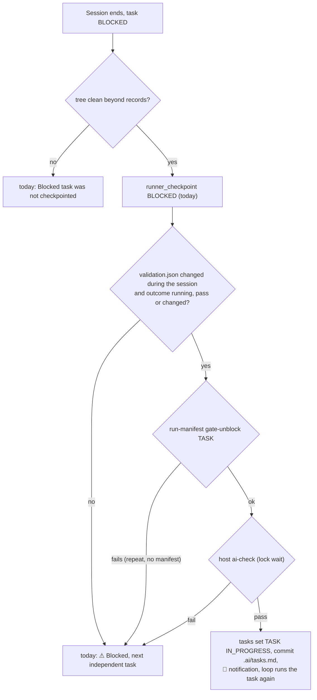

# Plan: Flow batch 8: FL-32 and N5

## Assessment (verified at c32f768, 2026-10-19)
See `.ai/project-spec.md`, "Verified against the code". In short: the prompts themselves tell a
session to mark a task BLOCKED when the foreground gate times out, and nothing on the host notices
that such a block had no failing check. The host gate after a DONE session already is the
authority, so the fix is mostly to stop the prompts from blocking, plus a narrow host retry for
sessions that still block (the frozen prompts of installed projects keep saying "mark BLOCKED"
until each project upgrades). N5 is a missing-list problem: one list must feed the guard and the
repair.

## Design

### FL-32 part 1: prompts (T037)
- The shared "How to work here" gate bullet (runner and triage, kept byte-identical) becomes:
  run the full gate as `.ai/bin/ai-check` with the Bash tool's `run_in_background: true`; wait for
  the completion notice and read its output (the exit status and the `Ran N tests` / `OK` or
  `FAILED` lines); make no edits and no commits while it runs (the stamp hashes the tree before and
  after: an edit makes it fail with `Validation modified project content`); do not end the session
  while it runs. If the result cannot be obtained, do not mark the task BLOCKED for that: finish the
  task on its targeted checks, write "full gate result unknown in the session; left to the host
  gate" in the result, and mark it DONE when everything else is met. The host runs the full gate
  after the session and sets a DONE task whose gate fails back to IN_PROGRESS. Targeted commands
  run in the foreground as written.
- The RUNNER CONTRACT in `scripts/ai-run` gains one sentence: a gate run that outlives a tool call
  is not a blocker; the host gate after the session decides.
- README setup step 4: the same rule in one sentence. `.ai/prompts/` (gate copy) is not edited.

### FL-32 part 2: host record and safe stamp reading (T038)
- `run-manifest gate-unblock TASK`: as `timeout-rerun` (validated ID, list `gate_unblocks` of
  unique IDs, at most 200, wrong shape = invalid manifest, a repeat fails `gate-only block: TASK
  was already retried once in this run` with bytes unchanged, kept by `clear-attempts`, dropped
  by `start`).
- `stamp outcome`: reads `.ai/local/validation.json` through `local_dir_fd` + `read_record` (no
  symlink, no FIFO block, size bound) and prints `WORD DIGEST`: WORD `none` (missing, unreadable,
  not JSON), `running`, `pass`, `changed` (`FAIL`, `exit_code` 0, `unchanged` false) or `fail`
  (anything else); DIGEST is the sha256 of the bytes read, or `-`.

### FL-32 part 3: the host gate waits for a running gate (T039)
- `scripts/ai-check`: `AI_CHECK_LOCK_WAIT` (`^[0-9]{1,5}$`, default 0; invalid → `ai_die`). With
  0: `flock -n` as today. Otherwise try `flock -n`; when held print `Waiting up to Ns for a running
  validation to finish.` and `flock -w N`; a timeout dies with the same `Validation is already
  running.` message.
- `scripts/ai-run`: `checkpoint_done` and the final gate (and T040's retry gate) run
  `AI_CHECK_LOCK_WAIT=<min(remaining, 900)>`. `ai-recover` and `ai-pipeline` unchanged.

### FL-32 part 4: gate-only block retry (T040, T041)

- In the loop, right before `claude_session`, `stamp_before` = the DIGEST of `stamp outcome`.
- The BLOCKED branch keeps the dirty check and `runner_checkpoint TASK BLOCKED` first (the
  session's bookkeeping is committed as today), and sends the ⚠ notification only when no retry
  happens. Then the predicate above; a pass: `ai_helper tasks set TASK IN_PROGRESS`, `git add --
  .ai/tasks.md .ai/state.md .ai/run-log.md`, commit `chore(ai): retry TASK after a gate-only block`,
  `ai_guard_verify`, notify `🔧 TASK: blocked without a failing check and the full gate passed;
  running it once more.`, `ai_log`. A failing host gate is recorded (`record_gate`) and does not
  stop the run: the task stays BLOCKED with the ⚠ notification. The host gate counts against the
  run time like the others.
- The next session's prompt (only for that task, once) adds: "The previous session marked TASK
  BLOCKED without a failing check; the host's full gate then passed on this tree. If the block was
  only about the gate result, verify the acceptance criteria and mark it DONE; otherwise block it
  again with the reason."
- T040 builds the path and its positive tests; T041 pins every case that stays as today and does
  the docs and flow chart (the T025/T026 split of batch 7).

### N5: one protected list (T042)
- `scripts/lib/common.sh`: arrays `AI_PROTECTED_PATHS` (the seven roots in today's order) and
  `AI_PROTECTED_OPTIONAL`, defined once near `ai_guard_digest`. The guard heredoc reads them from
  its arguments (`python3 -I - "${AI_PROTECTED_PATHS[@]}" -- "${AI_PROTECTED_OPTIONAL[@]}"` or an
  equivalent), with the same loop, so the digest value does not change.
- `workflow.py exec-bits ROOT...`: no argument → usage error; an index entry equal to a ROOT or
  below `ROOT/` is skipped. `ai-run` calls `ai_helper exec-bits "${AI_PROTECTED_PATHS[@]}"`.
  The old hard-coded `gate` tuple and `.ai/bin/` prefix go.

## Affected components
`templates/.ai/prompts/runner.md`, `templates/.ai/prompts/triage.md`, `scripts/ai-run`,
`scripts/ai-check`, `scripts/lib/workflow.py`, `scripts/lib/common.sh`, `tests/test_workflow.py`,
README.md, docs/workflow.md, vault `agents-flow.md` (+ hub Log lines).

## Phases and order
T037 (prompts, sonnet) → T038 (helpers, opus) → T039 (lock wait, opus) → T040 (retry path, opus)
→ T041 (unchanged cases, docs, chart, opus) → T042 (N5, sonnet) → T043 (audit, haiku).

## Risks
- The background wait depends on Claude Code delivering the finished result to a `claude -p`
  session; batch 7 evidence says it does. If it does not, the prompt's fallback (DONE on targeted
  evidence, host gate decides) still avoids the block. Needs-you check in the handoff.
- A session that ends with its background gate still running holds `validation.lock`: T039's wait
  covers it; the waiting adds up to one gate time.
- A retry spends one host gate run (~11 min) and one session on a task that really needed a human.
  Bounded to once per task per run (A1).
- The installed `.ai/prompts` of this repo stay old during this batch: sessions may still mark
  BLOCKED on the gate. The task queue header tells them not to.
- The guard digest refactor must keep the digest value; a test pins it against a reference copy of
  the old tuples.

## Validation strategy
Every task: its targeted `python3 -m unittest discover -s tests -k <group>` commands (must say
`Ran N tests`, N ≥ 1), then the full gate `.ai/bin/ai-check` run in the background and waited for
(see the queue header). The host's post-task `ai-check` is the authority. No profiling commands.
