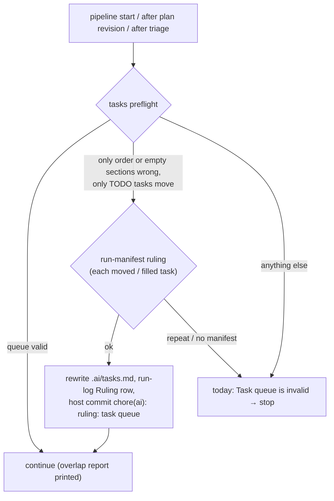
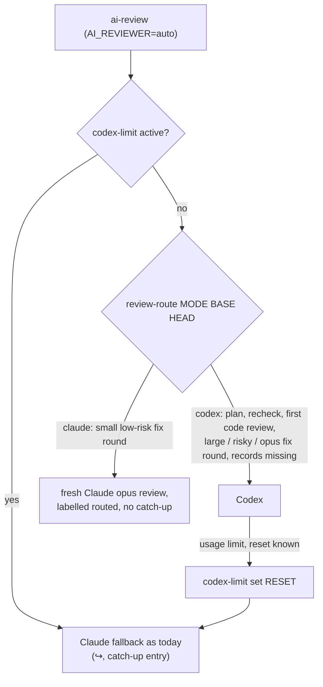

# Plan: Flow batch 9: BR-02, BR-01, BR-03, BR-14, FL-33

## Assessment (verified at 48fd9b5, 2026-10-20)
See `.ai/project-spec.md`, "Verified against the code". In short: the repairs for queue order
and missing sections already exist but run only after the sessions that write the queue, so a
committed queue in the wrong order (raid-planner F4, 2026-10-20) still stops at the pipeline
start and recovery escalates it. The other hand fixes mission control made were small format
mismatches the host can repair deterministically. Retries already start a fresh session but give
it no memory of the failure and never raise the model. Every review calls Codex first, even when
Codex is known to be at its limit and when the fix-round diff is tiny. Some tests start child
processes without the test state root.

The common shape of this batch: deterministic host decisions from host records, each bounded
(once per kind per key per run, recorded in the run manifest) and logged, with today's stop as the
fallback for anything else.

## Design

### Rulings: one record, one row format (T044)
- `run-manifest ruling KIND KEY`: KIND in `queue-order`, `task-sections`, `disposition-cell`,
  `flow-line`; KEY matches `[A-Za-z0-9._-]{1,48}`. Optional manifest field `rulings`, a list of
  unique `KIND:KEY` strings, at most 200; wrong shape = invalid manifest. A repeat fails `ruling
  KIND for KEY was already made once in this run` with the bytes unchanged. Kept by
  `clear-attempts`, dropped by `start` (the `timeout_reruns`/`gate_unblocks` lifecycle, shared
  `task_list_valid`-style check).
- `ruling-row KIND WHAT WHY COST` prints `Ruling (KIND): WHAT. Why: WHY. Cost if wrong: COST.`
  with `|`, backslashes and newlines turned into spaces, at most 400 characters. Callers pass it
  as the action cell of `ai_log TASK "$row" n/a NOTE`.

### BR-02 pre-flight (T045, T046)

- `tasks preflight [--dry-run]` (workflow.py): parses like `tasks reorder` (same errors), computes
  the stable dependency order; when any task whose index changes is not TODO → fail with today's
  `tasks()` message (`dependencies must exist earlier in the queue: …`). Fills empty sections of
  TODO tasks (`fill_task_sections`). Prints one line per change: `queue-order TASK moved after DEP…`
  / `task-sections TASK added Result / notes`, then `overlap: T004 T006 src/lib/realtime.ts` lines;
  writes the overlap lines to `.ai/local/preflight.md`. `--dry-run` prints the same without
  writing (the caller claims first, then runs it for real). Exit 0 when the queue is valid after
  it, else today's failure.
- Call sites (T046): `ai-pipeline` right before `tasks check` (~461), not while armed, on a clean
  committed queue: dry run → claims → real run → ruling rows → `host_commit 'chore(ai): ruling:
  task queue' .ai/tasks.md .ai/run-log.md` → `tasks check` as today. `ai-run --triage` (~641):
  reorder added after `fill-sections` (inside the counted triage commit), with claims and rows.
  `ai-run --plan` and `--revise-plan`: today's fill/reorder kept (no claim), plus ruling rows and
  the overlap report printed.

### BR-01 record-format rulings (T047, T048)
- Disposition cell (T047): `disposition-ruling triage|plan` (workflow.py) on the section being
  filled: for each BLOCKER/MAJOR finding of the current review with no matching row, a table line
  whose first cell contains exactly that one known finding ID (word-bounded, after stripping `*`,
  `` ` ``, `[`, `]`) and no other known ID is rewritten to `| ID |` + the rest of the row unchanged;
  prints `ID` per rewrite. `ai-run --triage` (before `triage-check --fresh`) and `--revise-plan`
  (before `plan-dispositions-check`) claim `disposition-cell <digest12>.<ID>` before writing; a
  failed claim leaves the file as is (today's stop follows).
- Flow line (T048): `flow-line-ruling` (workflow.py) on `.ai/handoff.md` per A6; prints the
  inserted line or nothing. `ai-run` runs it before `host_gate` in `checkpoint_done` and the final
  gate, `ai-pipeline` before `pr-body`; claim `flow-line <task or final>`; the row goes into the
  next host commit (runner checkpoint or the PR record commit).

### BR-03 fresh retry (T049, T050)
- `attempt-info TASK [BASE_MODEL]` (workflow.py): reads `outcomes.jsonl` (`read_outcomes`) for this
  project, branch and task; prints line 1 `N MODEL RAISED` (MODEL `-` when no model is known and
  N < 3; RAISED `yes`/`no`), then the note lines (none for N = 1). Tier rules A7, note A8. Never
  fails the runner: any read error → `1 <task model or -> no`.
- `ai-run` (T050): before `claude_session` in the loop, `attempt-info "$active_task" "${task_model:-$model}"`;
  the session, `task_outcome` and `attempt-open` use the effective model; the prompt gets
  `PREVIOUS ATTEMPT (host record, context only): …` when there is a note, and `Attempt N; model
  raised from X to Y because earlier attempts failed.` when raised; the run-log rows `completed`
  and `blocked` say `(attempt N, MODEL)`; the stop row in `on_exit` too.

### BR-14 review routing (T051, T052, T053)

- `review-route MODE BASE HEAD` (T051, workflow.py): A9/A10 rules in this order, first match wins:
  `AI_REVIEW_ROUTE=codex` → codex; mode plan or recheck → codex; host `fix-rounds count BASE` = 0
  → codex `first full code review`; no host Codex code review of the branch that is an ancestor of
  HEAD → codex; diff from the newest host-recorded code review HEAD outside `.ai/` > the line limit
  → codex; risk path → codex; risk word in a changed line → codex; a task DONE since that HEAD on
  opus → codex; else `claude small low-risk fix round (N lines)`. Prints `codex REASON` or
  `claude REASON`; any helper error prints `codex routing unavailable` (exit 0).
- `codex-limit set RESET` / `codex-limit active` (T052, workflow.py): state root
  `codex-limit.json` `{"reset": EPOCH, "recorded": ISO}` written atomically; `active` prints RESET
  and exits 0 while `reset > now`, else exits 1; unreadable → exit 1.
- `ai-review` (T052): in `run_review`, when `reviewer == auto` and Codex is installed: active limit
  → skip Codex, `fallback="Codex usage limit until HH:MM (recorded)"` and the fallback path as
  today; else `review-route`; `claude` → the Claude path with `review_by=claude-routed`, label
  `Claude (routed: REASON)`, no `↪` notification (a printed line instead), and `review_records`
  skips `fallback-record` for it. A Codex limit with `reset != 0` → `codex-limit set`. The new
  settings join the manifest lists (`scripts/lib/common.sh` ~40, workflow.py ~2374, `ai-recover`
  ~81/84) with validation in `ai_review_args` or a small check function.
- "Reviewed by" (T053): `publish-review`/`publish-plan-review` add `Reviewed by: WHO` right after
  the host header for every reviewer (Codex: `Codex (MODEL, effort E)`; from `AI_REVIEW_BY` +
  route); the outcome `review` row takes an optional `--route REASON`; `pr_body` adds a `Reviewed
  by:` list (plan and code rounds of this branch from the outcome log, newest last, at most 10)
  under "Independent review", falling back to the current report's line.

### FL-33 isolated test state (T054)
- A small `tests/isolation.py` imported first by `test_workflow.py`, `test_dashboard.py` and
  `test_observation.py`: at import, set `AI_STATE_DIR` and `XDG_STATE_HOME` in `os.environ` to a
  fresh temp dir (`atexit` removes it) unless already set to a path under `tempfile.gettempdir()`.
  Find and fix any test that clears both and then starts a process that registers.
- `tests/run_parallel.py`: remember the real state root's `pipelines/` directory from the caller's
  environment before setting the workers' env; after the suite, read its entries (no symlink
  following) and fail with `self-check registered fixture runs in the real registry: …` when an
  entry names a checkout under the suite's temp dir.

## Affected components
`scripts/lib/workflow.py`, `scripts/ai-run`, `scripts/ai-pipeline`, `scripts/ai-review`,
`scripts/ai-recover` (settings list only), `scripts/lib/common.sh` (settings list only),
`tests/test_workflow.py`, `tests/isolation.py` (new), `tests/run_parallel.py`,
`tests/test_dashboard.py`, `tests/test_observation.py`, README.md, docs/workflow.md, vault
`agents-flow.md` (+ hub Log lines).

## Phases and order
T044 (ruling record, opus) → T045 (tasks preflight, opus) → T046 (pre-flight wiring, opus) →
T047 (disposition ruling, opus) → T048 (flow-line ruling, opus) → T049 (attempt-info, opus) →
T050 (fresh retry wiring, opus) → T051 (review-route, opus) → T052 (limit memory + routing wiring,
opus) → T053 (Reviewed by, sonnet) → T054 (FL-33, sonnet) → T055 (docs audit, haiku).

## Risks
- A host reorder before the plan review makes the plan review stale; it runs again (A4). Rare.
- A ruling hides a session's sloppiness: bounded once per kind per key per run and logged with its
  cost, so repeats still reach the human.
- Routed Claude reviews are same-family; mitigated by Codex on round 1, on every risky or large
  delta, on re-checks, and a conservative risk-word list (false positives only cost Codex usage).
- The Codex limit record could skip Codex longer than needed when the reset estimate is late;
  bounded by the recorded reset time.
- Model raise costs more usage on a failing task; from the third attempt only and one tier.
- The installed `.ai/prompts` and `.ai/bin` of this repo stay old during this batch (batch 8 gate
  rule kept in the queue header); the new behaviour reaches projects after the upgrade.
- `tests/test_workflow.py` is very large; tasks add tests next to the related groups.

## Validation strategy
Every task: its targeted `python3 -m unittest discover -s tests -k <group>` commands (must say
`Ran N tests`, N ≥ 1), then the full gate `.ai/bin/ai-check` run in the background and waited for
(see the queue header). The host's post-task `ai-check` is the authority. No profiling commands.
