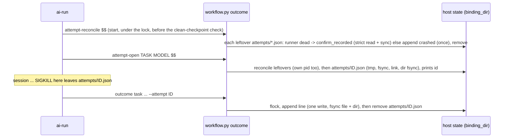

# Plan: Flow batch 5: FL-16, CU-5, R13

## Assessment (verified at df0d3c2, 2026-10-17)
Branch `fix/flow-batch-5` builds on PR #29 (`fix/flow-batch-4`, not merged). PR #29's T005/T016
gave both disposition tables one cell pattern (`TABLE_CELL`, `table_cell`) and line-bound rows
(`[ \t]*`); FL-16 builds on that. Details, line references and the list of backlog items
found already done are in `.ai/project-spec.md` ("Verified against the code").

## Architecture
### FL-16 — one finding-cell pattern for both tables (T001, T002)
- `scripts/lib/workflow.py`: a module constant `FINDING_CELL` (string, like `TABLE_CELL`) with
  exactly ONE capturing group (the ID); severity suffix and title text are non-capturing. Both
  `DISPOSITION_ROW` and `PLAN_DISPOSITION_ROW` start with `^\|[ \t]*` + `FINDING_CELL` +
  `[ \t]*\|`, so groups 1–4 (ID, disposition, evidence, task) stay as every reader uses them.
- Title text: after the ID (and suffix), a separator of whitespace, or `:` directly after the
  ID/suffix, optionally followed by `—`, `–` or `-` and whitespace (a dash needs whitespace or
  the suffix before it, so an ID like `SEC-1` or text `M1-2` is never split), then text that
  does not start with `(` and contains no unescaped `|` and no newline (reuse the `TABLE_CELL`
  alternation `(?:\\.|[^\\|\n])`). The text is ignored.
- Diagnostics: a helper `unmatched_cell_hint(text, finding)` returns ` (the row starting
  "| <first cell> |" does not match; write "| M1 | accepted | … | T012 |")` when a `|` line's
  first cell contains the ID (not preceded by a letter, digit or `-`, not followed by a digit,
  so glued forms like `M1x` get the hint too) but no row matched it. Appended to "MAJOR finding M1 has
  no disposition." and "Finding P1 has no row in the round N section." (prefixes unchanged, so
  existing `assertIn` checks hold).
- Prompts/contracts (T002): show `| M1 | accepted | <evidence> | T012 |` and
  `| P1 | accepted | <evidence> | T012 |`, ID alone (a severity suffix or title is tolerated).

### CU-5 — attempt marker + reconcile (T003 helper, T004 wiring)

- Markers: one file per attempt, `binding_dir() / 'attempts' / '<id>.json'` (per checkout,
  host state, outside agent-write roots), never overwritten (see the round 2 redesign below).
- Idempotence: every task outcome written with `--attempt` carries `attempt_id`; reconcile
  appends `crashed` only when no task record with that id exists, and removes the marker only
  through the removal gate below (round 3 redesign). A crash between append and unlink is
  therefore harmless.
- Liveness: pid alive AND `/proc/<pid>/stat` start time equal to the recorded one → a live
  runner owns it: leave it (should not happen under the lock; comment). Unknown start time
  recorded (no `/proc`) → treat a live pid as alive.
- Log I/O (T007, plan review round 1 P1–P3): one `append_outcome` for every kind opens the log
  `O_RDWR|O_APPEND|O_CREAT` (the newline guard `pread`s the last byte; a write-only fd cannot);
  if the log is non-empty and its last byte is not `\n`, the one `os.write` starts with `\n`;
  a return count below the encoded length is a failure (no fsync, no retry, marker kept, the
  next append's guard isolates the fragment). `read_outcomes` splits bytes on `\n` and decodes
  each line on its own, so a tail cut inside a multibyte character skips only that line.
  (The round 1 claim that concurrent writers can at worst produce an empty line was wrong
  without a lock: plan review round 2, P7; fixed below.)
  Known limit: a short write of a normal task line keeps the marker, so that attempt is later
  logged `crashed` (storage full; the conservative record).

### CU-5 write protocol (round 2 redesign, T008)
Rounds 1 and 2 both found BLOCKER/MAJOR gaps in the same area (how an outcome line and its
marker reach disk and when the marker may go), so the area is specified once, as a whole,
instead of per symptom:
1. **Append** (`append_outcome`, the only writer): open `O_RDWR|O_APPEND|O_CREAT` → `flock
   LOCK_EX` on that descriptor (every helper writer on the host, across checkouts) → tail
   check → one `write` (short = failure) → fsync file → fsync the log's directory and the
   parent of every directory just created → success. Any failure: no success, marker kept.
   The lock makes tail check + write atomic for helper writers (P7). Directory syncs make a
   new log durable before a marker can go (P8). Always prefixing `\n` was considered and
   dropped: existing tests and readers parse `splitlines()` of the log strictly (e.g.
   tests/test_workflow.py:2979, 5486, 5727), and blank lines would break them.
2. **Markers**: one file per attempt, created by tmp + fsync + `link` (fails on an existing
   name, so never overwritten) + dir fsync; removed (+ dir fsync) only after a successful
   append of a record carrying its id, or by reconcile once such a record exists.
3. **Reconcile** handles every marker on its own: unreadable → discard; live foreign runner →
   keep; dead runner, or the calling runner's own earlier attempt (same pid and start time;
   attempts are sequential under the checkout lock) → `crashed` unless its id is already in
   the log, then remove. `attempt-open` runs it with its own pid, so a retained marker is
   recorded at the next attempt, or at the next start at the latest, exactly once (P6).
Invariant: a marker is removed only when the log durably holds a record with its id; no
operation overwrites a marker. Residual: an older installed copy without the lock in another
checkout can interleave until upgraded; its buffered append only tears on a crash or full disk.
- `crashed` records: `seconds: null` (unknown; the report already uses `r.get('seconds') or 0`),
  branch/task/model from the marker, `attempt` numbered as today.
- Gate-broken stop: `on_exit` must not run a helper; ai-run asks for the marker directory once
  at start (`outcome attempt-dir`) and removes `<dir>/<attempt_id>.json` with `rm -f --` in
  that case.

### CU-5 marker-removal gate (round 3 redesign, T009)
Round 3 (P9, P10) found the round 2 invariant ("a marker is removed only when the log durably
holds a record with its id") broken on reconcile's decision inputs: the existing-record path
removed without any sync, and the reader it decided on returns `[]` for an unreadable log
(`read_outcomes`, workflow.py:2988–2991) as well as for an empty one. Third round in the
CU-5 marker area, so the decision inputs are redesigned once instead of patched per path:
1. **Strict read.** `read_outcomes(paths, strict=False)` keeps today's lenient mode for
   reports (`OSError` → skip the file). `strict=True` treats only a missing file as an empty
   log and lets every other `OSError` propagate. Reconcile and attempt numbering inside it use
   the strict mode; a read failure keeps the marker, prints a note and appends nothing.
2. **Confirmation.** `confirm_recorded(path, attempt_id) -> bool` is the ONLY way reconcile
   may conclude "already recorded": open the log `O_RDWR` (missing → False, nothing created),
   `flock LOCK_EX`, read the descriptor to EOF with the per-line decoder of T007, look for a
   task record with that `attempt_id`; absent → False; present → `fsync` the descriptor, then
   `fsync_dir` of the log's directory → True. Any `OSError` propagates (caller keeps the
   marker). Rationale: a complete write whose file or directory sync failed leaves a readable
   line and a retained marker; the retry at reconcile must finish the sync before the marker
   may go (P9).
3. **One removal rule.** A marker is removed after `append_outcome` returned True for a record
   carrying its id (`outcome task --attempt`, and reconcile's `crashed` append: the append
   already synced under the lock), or after `confirm_recorded` returned True. No other path
   removes a readable marker. `confirm_recorded` and a following `append_outcome` take the lock
   separately; no duplicate can slip in between because attempts of a checkout are sequential
   under its lock, so no other writer appends that id.
Residual (comment + Risks): after a failed `fsync` Linux may already have marked the dirty
pages clean, so the retried sync can only persist what is still dirty; the gate guarantees a
successful sync attempt before removal, not recovery from a kernel that dropped the data. Still
advisory telemetry: never fatal, never a stop.

### CU-5 start order in ai-run (round 3, P11)
`ai-run:626` writes tracked `.ai/state.md` (`update_state`, workflow.py:763–785) before every
task session, so a runner killed during a session always leaves a dirty checkout, and
`ai-run:136–137` refuses a dirty checkout before the gate baseline at :148. The reconcile
therefore runs right after `ai_branch` (:114), before the clean-checkpoint refusal, in every
non-`--plan` mode: best effort, host state only, through the same checkout helper that
`state-root-check` (:109) already runs there (no new trust class; the gate baseline stays at
:148). The first restart after a kill logs the `crashed` attempt and then refuses with
`Start from a clean checkpoint`; the human (or the recovery session) commits the leftovers,
and the next start runs the task. T004's end-to-end test follows exactly this order.

### CU-5 marker failure contract (round 4 redesign, T010)
Round 4 (P12, P13) found two more marker paths whose failure outcome was unspecified: a
transient error while READING a marker was treated like invalid content and discarded, and a
failure of `attempt-open` AFTER the marker was linked left a marker whose id the runner had
cleared (`|| attempt_id=`), so a finished task was later logged `crashed` and the report
(`outcomes_report`, workflow.py:3093, last line per task wins) showed it as not done. Fourth
round in the CU-5 marker area, so the failure semantics of every marker operation are stated
once, as a contract, instead of per path:
1. **Publish** (`open_attempt`, used by `outcome attempt-open` after its reconcile): choose the
   id, PRINT it to stdout and flush, THEN publish the marker (dir, tmp, fsync, link, unlink
   tmp, dir fsync). Any failure after the print: stderr note, exit 1, marker possibly present.
   The runner keeps every valid id the command printed, whatever its exit status:
   `attempt_id=$(ai_helper outcome attempt-open … 2>/dev/null) || true`, then
   `[[ "$attempt_id" =~ ^[0-9a-f]{16}$ ]] || attempt_id=`. Asymmetry that makes this safe: an
   id WITHOUT a marker is harmless (the outcome line carries it, `remove_marker` of a missing
   file is a no-op, nothing reconciles it), while a marker without an id in the runner
   produces a false `crashed` line; printing first means a marker can only exist once the
   runner has its id (a write to the closed pipe fails before the link).
2. **Read** (`list_markers`): every `*.json` entry is classified three ways, never raising
   for one file: a valid record; invalid content (`None`: read completely, but not JSON, missing
   fields, or `id` different from the file name), which reconcile discards with its note (our
   writer links only complete, fsynced files, so invalid content under the final name is
   foreign or corrupt, never a torn marker of ours); a read error (the `OSError` instance:
   open/read failed), which reconcile keeps, notes and skips, going on with the next marker.
   A listing failure (`scandir` raising) is a note, exit 0, nothing touched.
3. **Remove**: unchanged, T009's one removal rule.
Invariant: no marker is discarded because of a transient failure, and every marker that
exists is either held by a runner that knows its id or reconcilable as a dead runner's.
Residual: a marker whose directory sync failed after the link may not survive a power loss;
that loses at most a `crashed` record, never produces a false one.

### R13 — boundary cut + full text (T005)
- `shorten(text, cap)` in workflow.py: whitespace collapsed; ≤ cap → unchanged; else the longest
  prefix ending at a sentence end (`.`, `!`, `?` followed by a space) within `cap - 1` characters
  when it keeps at least half the cap, else at the last space, else hard cut; then `…`.
- `recover_decision`: `clean` uses it; when the reason or human action was cut, it writes both in
  full (collapsed, at most 4000 characters each) to `.ai/local/recovery-decision.txt`
  (`atomic`); it removes a stale file at the start of every call. Output stays three TSV fields.
- `ai-recover` `escalate`: when the file exists, the ⛔ notification ends with
  `Full text: .ai/local/recovery-decision.txt`. `ai-recover` removes the file right after its
  lock, so an early escalation never names a previous invocation's text (plan review P4).
- `bounded_questions` uses `shorten(…, QUESTION_CAP)` (no file: the questions' full text is in
  `plan-dispositions.md`, which the existing pointer line names).

## Phases / tasks
| Task | Item | Model | Depends |
| --- | --- | --- | --- |
| T001 | FL-16 finding cell pattern + hint | sonnet | none |
| T002 | FL-16 prompts and contracts show the row form | haiku | T001 |
| T007 | CU-5 log I/O: readable append fd, complete-write check, per-line UTF-8 reader | opus | none |
| T008 | CU-5 write protocol: locked append + dir sync, per-attempt marker store | opus | T007 |
| T009 | CU-5 marker-removal gate: strict read, `confirm_recorded` (round 3 redesign) | opus | T008 |
| T010 | CU-5 marker failure contract: three-way marker read, id printed before publish (round 4 redesign) | opus | T009 |
| T003 | CU-5 helper: marker, reconcile (uses T007/T008/T009/T010) | opus | T010 |
| T004 | CU-5 ai-run wiring (reconcile before the clean-checkpoint check, id kept on a failed open), SIGKILL end-to-end, docs, flow chart | opus | T003 |
| T005 | R13 boundary cut and full recovery text | sonnet | none |
| T006 | Docs, handoff and final audit | haiku | T001–T005, T007, T008, T009, T010 |

## Risks
- FL-16 loosening could let a row meant for two findings count for one: it only ever counts
  for its FIRST ID, and every BLOCKER/MAJOR still needs its own row, so a missing one still
  fails. `test_triage_severity_suffix_other_decorations_stay_unmatched` changes on purpose
  (`M1 (MAJOR) x` now matches); its other cases stay.
- CU-5 durability: plan reviews of `fix/catchup-review` (rounds 5–7) found edge cases in a
  larger design (incomplete appends, durability of existing rows, unique ids). This plan keeps
  only: unique random ids, one locked write per line with a newline guard, fsync of the new
  line, the marker and the directories they live in, one never-overwritten marker per attempt,
  reconcile idempotent by id, marker removal only after a strict read and a successful sync,
  markers kept on read errors and ids kept by the runner on a failed open
  (designs: "CU-5 write protocol", "CU-5 marker-removal gate", "CU-5 marker failure
  contract"). Durability of earlier rows is a non-goal
  (advisory telemetry; nothing automatic reads it). A reviewer finding beyond that scope should
  be deferred, not grown into a redesign tonight.
- CU-5 sync retry limit: after a failed `fsync` the kernel may have dropped the dirty pages, so
  `confirm_recorded`'s retried sync cannot restore them; the gate only guarantees that no
  marker is removed without a successful sync attempt (T009 comment and docs).
- CU-5 false crash: `outcomes_report` takes a task's LAST line as its result (workflow.py:3093),
  so a `crashed` line appended for an attempt that actually finished would hide its `done`.
  The marker failure contract (T010) rules that out for a failed `attempt-open` (the runner
  keeps the printed id) and for a transient marker read error (the marker is kept, not
  discarded); the only remaining source is the documented short-write case.
- CU-5 restart: a killed runner always leaves `.ai/state.md` dirty (ai-run:626), so the
  reconcile runs before the clean-checkpoint refusal (ai-run:136) and the restart still stops
  there until the leftovers are committed; T004's test and the handoff state this order.
- CU-5 end-to-end test kills `ai-run` with SIGKILL: its `timeout`/mock children are orphaned;
  the test must kill them in `addCleanup` (the self-check's subreaper from PR #29 also cleans
  up on failure).
- Time: about 5 h until 09:00 with ~7 min per gate run; T003/T004 are the long ones.

## Validation strategy
Per task: the targeted `-k` groups in `.ai/tasks.md`, then `.ai/bin/ai-check` in the
foreground (600000 ms tool timeout). Tests with time bounds use `tests/timeouts.py` scaling.

## Assumptions (unattended run; recorded instead of asked)
- FL-16: tolerating title text after the ID is acceptable (the backlog offers "accept" or
  "show the form"; both are done). Text before the ID or unknown parenthesised words stay
  unmatched.
- CU-5: worth doing now in the limited form above although its backlog note says "do when
  outcome data drives automatic decisions"; the planner judged the limited form small and safe.
  Only implementation attempts are tracked (as today).
- R13: the 300-character caps stay; only where the cut falls and where the full text goes change.
- R15 is a publishing-policy decision for Zack, so it is listed as a human todo, not planned.
- The batch builds on PR #29; if #29 changes before merging, this branch is rebased or merged
  by the human.
